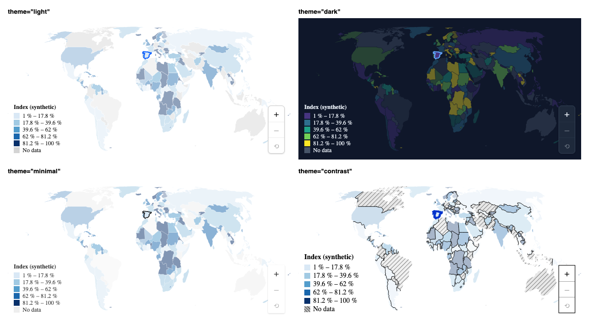

# choropleth-kit



Choropleth (thematic) maps for React: SVG on top of `d3-geo`, with zoom, drill-down between levels,
legends, tooltips and theming. The common case is **ten lines**, and when you need more you can drop
down a level without rewriting anything.

- **Three API levels, one implementation:** `<ChoroplethMap>` (preset) → `<Choropleth.Root>` and its pieces (compound) → `useChoropleth` (headless).
- **Four variants:** `sequential`, `diverging`, `categorical` and `bubble` (size + color).
- **Camera:** zoom and pan with a cooperative wheel, pinch, inertia, controls and programmatic flights (`await map.zoomTo("ES")`).
- **Drill-down:** world → country → region → stores, declaring the levels once.
- **Performance:** hover, zoom and pan do not re-render the map (interaction state lives outside React).
- **Theming:** `--cm-*` variables, four themes, `classNames` (Tailwind) and a `data-*` contract.
- **Two maps on the same page never share ids** (patterns, filters).

> Status: **MVP (v0.1)**. The API may change before 1.0. What is left out of the MVP and the known
> issues live in [`evolution-and-issues/`](./evolution-and-issues/README.md).

## Installation

```bash
pnpm add choropleth-kit        # or: npm i choropleth-kit / yarn add choropleth-kit
```

Requires `react` and `react-dom` ≥ 18 (peer dependencies). The package is **ESM only** and ships its own types.

## A map in 10 lines

```tsx
import { ChoroplethMap } from "choropleth-kit";
import { world110m } from "choropleth-kit/geo"; // world at 1:110m with ISO alpha-2 ids ("ES")
import "choropleth-kit/styles.css";

const data = [
  { country: "ES", sales: 120 },
  { country: "FR", sales: 95 },
  { country: "DE", sales: 150 },
];

export const SalesMap = () => (
  <ChoroplethMap
    geography={world110m}
    objectName="countries"
    data={data}
    getId={(row) => row.country}
    getValue={(row) => row.sales}
    variant="sequential"
    legend={{ title: "Sales" }}
  />
);
```

The map takes the width of its container. Regions without data are painted as "no data" (gray, or
hatched with `emptyPattern`). If an id in your data does not match any region, in development the
console shows a warning that explains it (and `onJoinReport` gives you the full report).
In development the console also reports how many regions have no data (with a 3-country sample you
will see `172 region(s) have no data`); `diagnostics={false}` turns it off.

## What to import from where

| Import                      | Contents                                                                                     |
| --------------------------- | -------------------------------------------------------------------------------------------- |
| `choropleth-kit`            | React components and hooks (`ChoroplethMap`, `Choropleth.*`, `useChoropleth`, `useCamera`…). |
| `choropleth-kit/styles.css` | Base styles (everything uses `:where()` and `--cm-*` variables, easy to override).           |
| `choropleth-kit/core`       | Pure functions with no React or DOM (scales, classification, camera, drill machine, `es`…).  |
| `choropleth-kit/geo`        | Geodata: `world110m`, `isoNumericToAlpha2`, `worldFallbackPoints` (microstates as points).   |

`geo` weighs ≈ 40 KB gzip (it is data): if you bring your own geography (TopoJSON or GeoJSON, also
async with `() => import("./map.json")`), do not import it and it stays out of your bundle.

## Variants

```tsx
// Categories with fixed colors
<ChoroplethMap {...common} variant="categorical" getCategory={(r) => r.zone} />

// Diverging (with a midpoint)
<ChoroplethMap {...common} variant="diverging" getValue={(r) => r.growth} midpoint={0} />

// Bubbles with their own coordinates (stores): size = sales, color = change
<ChoroplethMap
  {...common}
  variant="bubble"
  getValue={(s) => s.sales}
  getColorValue={(s) => s.growth}
  getCoordinates={(s) => s.at} // [lon, lat]
/>
```

## Interaction

```tsx
const [selectedId, setSelectedId] = useState<string | null>(null);

<ChoroplethMap
  {...common}
  selectedId={selectedId}
  onItemClick={({ id }) => setSelectedId(id)}
  onItemHover={(item) => console.log(item?.id)}
  zoom={{ wheel: "cooperative", controls: true }} // the wheel only zooms with Ctrl/⌘
  renderTooltip={({ label, formattedValue }) => (
    <b>
      {label}: {formattedValue}
    </b>
  )}
/>;
```

- `zoom={false}` turns the camera off. By default the wheel zooms with the mouse over the map
  (`wheel: "always"`); if the map lives in a scrolling page, use `"cooperative"`.
- The **imperative handle** (`ref`) returns _promises_, so flights can be chained without timers:

```tsx
const ref = useRef<ChoroplethMapHandle>(null);
await ref.current?.zoomTo("ES");
await ref.current?.zoomTo("FR");
ref.current?.getView(); // { zoom, center, bounds, level… }
```

- `onViewChange` fires **at the end** of each gesture or flight, never per frame. Inside the compound,
  `useCamera((view) => view.zoom > 3)` subscribes to that confirmed camera with a selector.

## Drill-down

```tsx
import { ChoroplethMap, defineDrillLevels } from "choropleth-kit";

const levels = defineDrillLevels<Row>([
  { id: "country", label: "Countries", geography: world110m, objectName: "countries" },
  {
    id: "region",
    geography: ({ parentId }) => import(`./geo/admin1/${parentId}.json`), // loaded on demand
  },
]);

<ChoroplethMap
  drill={levels}
  data={({ depth, parentId }) => rows.filter((r) => r.depth === depth && r.parentId === parentId)}
  getId={(r) => r.id}
  variant="sequential"
  getValue={(r) => r.value}
/>;
```

The library loads **geometry**, never business data: you pass the `data` of the current level. There
are breadcrumbs (`Breadcrumb`), Escape/Backspace to go up, `onDrillIntent` (for prefetching), and it can
be driven from the URL with `useDrillDown({ path, onPathChange })`. On touch, the first tap on a
drillable region previews it and the second one drills down.

## Theming

```tsx
<ChoroplethMap {...common} theme="dark" emptyPattern="hatch" />
```

- Themes: `"light"`, `"dark"`, `"minimal"`, `"contrast"`; or an object built with `defineTheme` / `extendTheme`.
- Any `--cm-*` variable can be overridden on an ancestor (`--cm-border-color`, `--cm-hover-stroke`…).
- `classNames={{ root: "…", tooltip: "…" }}` (also `region`, `legend`, `controls`, `breadcrumb`…) adds your classes
  (Tailwind, CSS Modules) to the `cm-*` ones; states are exposed as `data-*` attributes on the regions
  (`data-class`, `data-empty`, `data-drillable`…) so you can style them with selectors.
- `unstyled` removes all the base CSS.
- UI texts are in English and can be replaced with `labels` (a Spanish pack ships with the library: `import { es } from "choropleth-kit/core"`).

## Show only a continent, a subregion or some countries

`region` restricts the map **from the first frame**: no zoom animation, no world around it, and the
map fills its container.

```tsx
<ChoroplethMap geography={world110m} objectName="countries" region="europe" data={rows} … />
<ChoroplethMap … region="westernEurope" />        // a subregion
<ChoroplethMap … region="eu27" />                 // a political / commercial grouping
<ChoroplethMap … region="ES" />                   // one country
<ChoroplethMap … region={["ES", "PT", "MA"]} />   // some countries
<ChoroplethMap … region={["iberia", "MA"]} />     // presets and codes can be mixed
```

- **Presets** (`REGION_PRESETS` in `choropleth-kit/geo`): continents (`africa`, `asia`, `europe`,
  `northAmerica`, `southAmerica`, `oceania`), the UN subregions (`westernEurope`, `southeasternAsia`,
  `caribbean`, `usAndCanada`…) and groupings (`eu27`, `nordics`, `iberia`, `latam`, `mena`). An unknown
  name throws an error that lists the valid ones.
- **Russia is in no preset** (it spans two continents and would dominate the framing): ask for it with
  `region="RU"`. Turkey, Cyprus and the Caucasus count as Asia.
- **Regions across the date line are re-centered**: Oceania (Fiji, New Zealand…) and Russia (Chukotka) would be
  torn across both edges of a world map, so their projection is rotated. Regions that do not touch ±180°
  keep the world's orientation.
- **Overseas territories are left out** (French Guiana, Svalbard, Hawaii…) so they do not shrink the
  framing. `world110m` does not draw the Canary Islands, the Azores or the Caribbean anyway.
- **Your data can be worldwide**: rows for countries outside the region are ignored without warnings and
  listed in `joinReport.outOfRegion`. A typo (`"UK"`) still warns.
- **It works with `drill`**: `region` restricts the root level; the levels below bring their own geometry,
  and going back up returns to the region.
- It matches `feature.id` (or your `getFeatureId`) against ISO alpha-2 codes, so it needs a geometry that
  uses them, like `world110m`.

## Geodata and borders

`world110m` is Natural Earth 1:110m (public domain) with ISO alpha-2 ids, Kosovo (`XK`) included.
Northern Cyprus and Somaliland have no id and are painted as a non-interactive layer.

> ⚠️ **Disputed borders** (Western Sahara, Crimea, Kashmir…) follow Natural Earth's _de facto_ boundaries.
> If you publish the map in a product, check that they are what you want to show. You can always pass your
> own geography through the `geography` prop.

## Size

Measured with [`size-limit`](https://github.com/ai/size-limit) (gzip, minified; `pnpm size`):

| What                                                      | Gzip    |
| --------------------------------------------------------- | ------- |
| Own code (`core` + `react`, dependencies external)        | ≈ 31 KB |
| `ChoroplethMap` with all of `d3` included (without React) | ≈ 74 KB |
| `styles.css`                                              | ≈ 2 KB  |
| `choropleth-kit/geo` (data)                               | ≈ 40 KB |

## Compatibility and known limits

- ESM only. In CommonJS: `await import("choropleth-kit")`.
- **Full accessibility** (arrow-key navigation between regions, alternative table, `aria-live`
  announcements) is **not in the MVP**. Today there is semantic structure in the breadcrumb, `Escape`
  and keyboard zoom.
- Out of the MVP: label/marker layers, ⭐ animations, SVG/PNG export, globe, clustering. List and
  priorities in [`evolution-and-issues/`](./evolution-and-issues/README.md).

## Development

```bash
pnpm install          # pnpm only
pnpm storybook        # living documentation: one story per case
pnpm verify           # typecheck + lint + format + tests + build + size + publint/attw
```

Planned features and known issues: [`evolution-and-issues/`](./evolution-and-issues/README.md).
Rules for coding agents: [`AGENTS.md`](./AGENTS.md). Publishing steps: [`PUBLISHING.md`](./PUBLISHING.md).

## Data and third-party notices

- **Geometry** in `choropleth-kit/geo` is derived from [`world-atlas`](https://github.com/topojson/world-atlas)
  (ISC License, Copyright (c) Mike Bostock), which is built from [Natural Earth](https://www.naturalearthdata.com/)
  (public domain).
- The ISO 3166 numeric → alpha-2 table was generated at build time with
  [`i18n-iso-countries`](https://github.com/michaelwittig/node-i18n-iso-countries) (MIT).
- Runtime dependencies (`d3-*`, `topojson-client`, `polylabel`) are ISC-licensed and installed separately.

## License

[MIT](./LICENSE) © Manuel Martín
