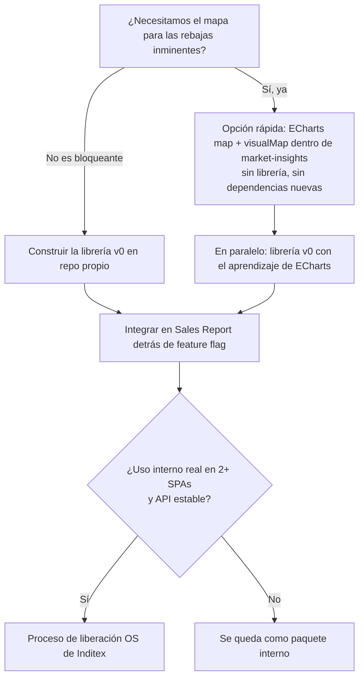
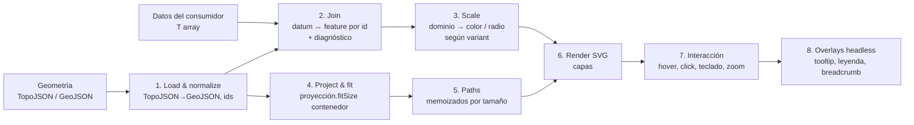
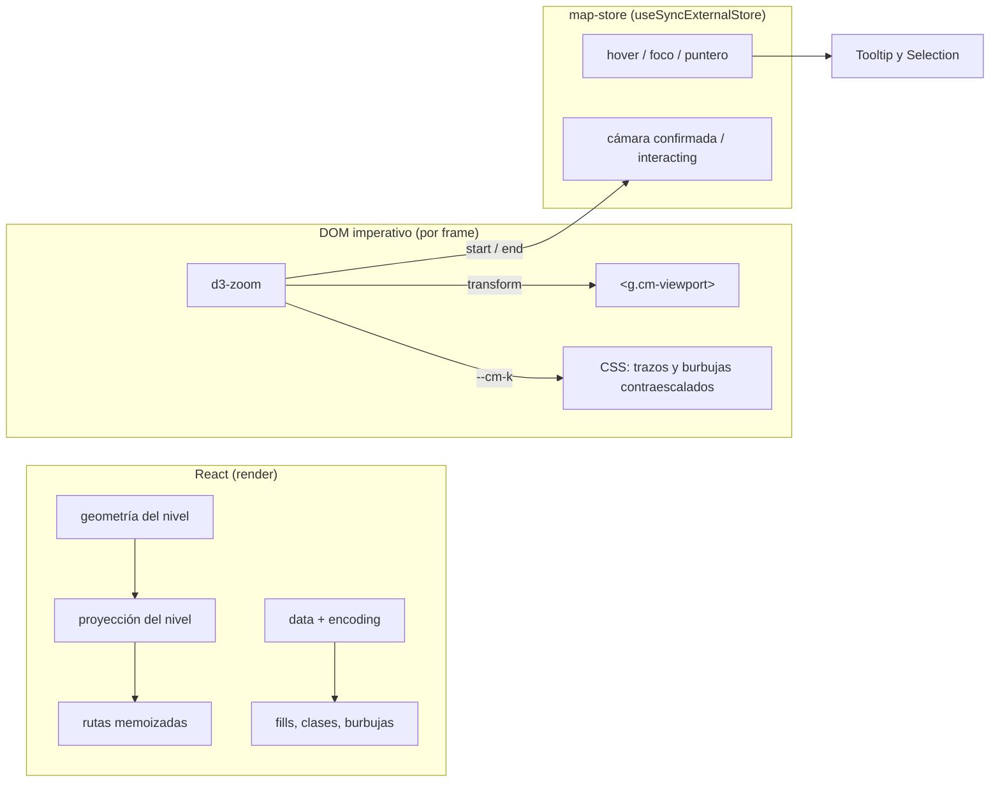
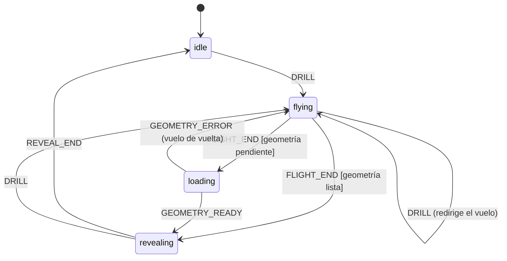

# Librería de mapas de coropletas: briefing de implementación

> Estado: **briefing vivo**. v0.1 implementada (ver `choropleth-build-proccess.md`, pasos 1-13).
> Revisión 2 (Opus 5.5): §11 (zoom, pan y drill-down) y §12 (interacción, estilado y animaciones)
> reescritas en detalle; nueva §21 con el handoff de v0.2-v0.4 para Sonnet.
> Público: desarrolladores frontend sin experiencia previa con mapas y el agente que implemente.
> Origen: conversaciones con Gemini, Claude y Grok, revisadas y contrastadas con la feature
> `market-insights` de Sales Report.
>
> **Alias**: en el código y en el diario de construcción este documento se cita como `dd.md`.
> Los números de sección (§0-§20) son estables: el código los referencia en comentarios.

**Principio rector de todo el documento**: la librería compite por **UX** (un mapa que se siente
fluido, legible y bonito sin configurar nada) y por **DX** (la API correcta es la más corta, los
errores se explican solos y TypeScript guía). Ante cualquier duda de diseño, gana la opción que
haga el caso común más corto y el caso avanzado posible sin _forks_.

---

## 0. Resumen ejecutivo

| Pregunta                                               | Respuesta corta                                                                                                                                                                                                                                                                                                                                                                                                                               |
| ------------------------------------------------------ | --------------------------------------------------------------------------------------------------------------------------------------------------------------------------------------------------------------------------------------------------------------------------------------------------------------------------------------------------------------------------------------------------------------------------------------------- |
| **1. ¿Hay hueco en el ecosistema React/JS?**           | **Sí, pero estrecho.** Hay muchas piezas (d3-geo, nivo, ECharts, MapLibre, react-simple-maps), pero ninguna reúne a la vez: React idiomático, _tooltips headless_, presets por tipo de mapa, _drill-down_ jerárquico controlado por datos, buenas prácticas cartográficas por defecto y diagnóstico de errores de cruce de datos. El hueco no está en pintar el mapa, sino en la **experiencia de desarrollo** para quien nunca ha hecho uno. |
| **2. ¿Sirve para varios casos de uso?**                | **Sí.** Todo mapa temático es _geometría + un dato por lugar + una regla visual_. Ventas por mercado, elecciones, salud pública, analítica SaaS por país o precios inmobiliarios encajan en el mismo modelo de datos.                                                                                                                                                                                                                         |
| **3. ¿Merece la pena?**                                | **Como pieza interna, sí**: el coste es moderado y reutilizable en otras SPAs de Inditex. **Como open source exitoso**, solo si aportamos geodatos listos, documentación muy buena y mantenimiento. Recomendación: construirla _preparada para OS_ (agnóstica, sin datos internos) y decidir la publicación cuando haya uso interno real. **No acoplar la entrega de rebajas a la librería** (ver §6.4).                                      |
| **4. ¿Hay una API mínima viable? ¿Presets por props?** | **Sí.** Un componente `<ChoroplethMap>` con `variant="sequential" \| "diverging" \| "categorical" \| "bubble"` cubre la mayoría de casos. El `variant` es azúcar sintáctico sobre un sistema de capas componibles y un hook _headless_ para quien quiera control total. Ver §9 y §10.                                                                                                                                                         |
| **5. ¿Motor?**                                         | **SVG + d3-geo para la v1**, no MapLibre ni un motor propio. Nuestro caso (unos 250 países, decenas de zonas, cientos o pocos miles de tiendas, sin calles ni mapa base) cabe de sobra en SVG, que además es más ligero, más fácil de exportar a imagen y más fácil de entender. Si aparecen límites de rendimiento, primero Canvas para los puntos y después WebGL.                                                                          |

**Nota sobre lo que dijo Grok ("3D no sé qué")**: casi seguro se refería a **d3** (D3.js, _Data-Driven
Documents_), no a 3D. D3 es la librería de visualización de datos de referencia en JavaScript. Sus
módulos `d3-geo` y `d3-zoom` son la base de `react-simple-maps` y serán la base de esta librería.
(Curiosamente, con d3-geo también se puede pintar un globo terráqueo "3D" con poco esfuerzo; ver §17.)

---

## 1. Contexto y objetivo

### 1.1 Origen en Inditex

En Sales Report, `market-insights` (ver [market-insights/market-insights.md](market-insights/market-insights.md))
compara un mercado contra sus **zonas**, **tiendas** o **compradores** mediante un ranking de barras
en ECharts. Los datos ya disponibles permiten:

- Indicadores por mercado: venta acumulada (importe y unidades), últimos 7, 3 y 1 días.
- Comparativa **A vs A-1** (variación %) y venta absoluta.
- **Peso** de cada mercado sobre la venta total.
- Desglose **mercado → zona → tienda**, con canal (TF / .COM) y ciclo de vida (operativa / nueva).

Un mapa añade algo que el ranking no da: **patrones geográficos** (p. ej., "todo el norte de Europa
cae y el sur crece") y **navegación espacial** (del mundo a un mercado, de ahí a sus zonas y tiendas).

### 1.2 Objetivo de la librería

Un componente React (con núcleo reutilizable desde JS sin framework) para crear mapas temáticos que:

- Funcione con **cualquier mapa del mundo o de un país**, no solo con datos de Inditex.
- Permita **zoom in/out**, _pan_ (arrastrar) y **drill-down** entre niveles (mundo → país → región → punto).
- Permita rotar entre **indicadores**, **niveles**, **paletas** y **tipos de mapa** cambiando props.
- Tenga **hover**, **selección**, **animaciones**, **leyendas personalizables** y **tooltips headless**.
- Sea **bonito por defecto** y **adaptable** (temas mediante variables CSS).
- Sea **fácil de entender**, tanto para quien la usa como para quien lee su código.

### 1.3 No objetivos (al menos en v1)

- No es un mapa de navegación (sin calles, rutas ni búsqueda de direcciones).
- No usa _tiles_ (teselas) ni mapa base de satélite o callejero.
- No incluye cartogramas (deformar países según el dato): son caros y de nicho.
- No hace _fetch_ de datos de negocio: el consumidor trae los datos (React Query en nuestro caso).

---

## 2. Conceptos básicos para quien nunca ha trabajado con mapas

Lee esta sección antes que nada. Casi toda la documentación de mapas da estos términos por sabidos.

### 2.1 Coordenadas: longitud y latitud

Cualquier punto de la Tierra se describe con dos números:

- **Longitud** (_lng_, _lon_, x): de -180 a 180. Este-oeste. Madrid ≈ -3.70.
- **Latitud** (_lat_, y): de -90 a 90. Norte-sur. Madrid ≈ 40.42.

⚠️ **Trampa clásica**: GeoJSON y d3 usan el orden `[lng, lat]`, mientras que Google Maps y muchas APIs
usan `lat, lng`. Si ves una tienda de Madrid en Somalia, has invertido el orden.

### 2.2 GeoJSON

Es **JSON estándar (RFC 7946) para describir formas geográficas**. Lo puedes abrir con un editor de texto.

```json
{
  "type": "FeatureCollection",
  "features": [
    {
      "type": "Feature",
      "id": "ES",
      "properties": { "name": "Spain" },
      "geometry": {
        "type": "Polygon",
        "coordinates": [
          [
            [-9.3, 43.0],
            [3.3, 42.4],
            [-1.8, 36.8],
            [-9.3, 43.0]
          ]
        ]
      }
    }
  ]
}
```

- **Feature**: un "lugar" (un país, una provincia, una tienda). Tiene `geometry` (la forma),
  `properties` (datos libres, como el nombre) y, opcionalmente, `id`.
- **FeatureCollection**: una lista de features. Un "mapa de países" es una FeatureCollection.
- **Tipos de geometría**:
  - `Point`: un punto, como una tienda.
  - `Polygon`: un área cerrada, como un país sin islas.
  - `MultiPolygon`: varias áreas, como España con Baleares y Canarias.
  - `LineString` / `MultiLineString`: líneas, como ríos o fronteras.

**Problema de GeoJSON**: es redundante. La frontera entre España y Francia se guarda dos veces, una en
cada país, y además con muchos decimales. Un mapa del mundo detallado en GeoJSON pesa varios MB.

### 2.3 TopoJSON

Es una **versión comprimida de GeoJSON** (creada por el autor de D3) que guarda **topología**:

- Las fronteras compartidas (**arcos**, _arcs_) se guardan **una sola vez** y cada país dice "estoy
  formado por los arcos 12, 13 y -40".
- Las coordenadas se **cuantizan**: se convierten a enteros en una rejilla, lo que ahorra mucho espacio.
- Resultado: suele ocupar **bastante menos** que el GeoJSON equivalente.

En el navegador no se pinta TopoJSON directamente: se convierte a GeoJSON con `topojson-client`:

```ts
import { feature, mesh, merge } from "topojson-client";

const countries = feature(topology, topology.objects.countries); // -> FeatureCollection
const borders = mesh(topology, topology.objects.countries, (a, b) => a !== b); // fronteras interiores, cada una una sola vez
const iberia = merge(topology, [spainGeometry, portugalGeometry]); // une varios polígonos en uno
```

`mesh` y `merge` son importantes para nosotros:

- **`mesh`** permite pintar las fronteras una sola vez (más fino, más bonito y más rápido).
- **`merge`** permite **construir zonas comerciales** uniendo regiones administrativas. Si una
  "zona" de Inditex es "provincias X + Y + Z", se calcula su contorno en el cliente sin crear
  geometría a mano (ver §7.4).

**Regla práctica**: los geodatos se **distribuyen** como TopoJSON y se **usan** como GeoJSON.

### 2.4 Proyección

La Tierra es (casi) una esfera y la pantalla es plana. Una **proyección** es la fórmula matemática que
convierte `[lng, lat]` en `[x, y]` de píxeles. **Todas las proyecciones deforman algo**: áreas,
formas, distancias o ángulos.

| Proyección                   | Qué es                                                                                                                                                                         | ¿Para coropletas?                                                                                                     |
| ---------------------------- | ------------------------------------------------------------------------------------------------------------------------------------------------------------------------------ | --------------------------------------------------------------------------------------------------------------------- |
| **Mercator**                 | La de Google Maps. Conserva formas locales, pero **infla enormemente** las zonas cercanas a los polos: Groenlandia parece del tamaño de África y es unas 14 veces más pequeña. | ❌ Para el mundo no. Rusia, Canadá o los países nórdicos parecerían mucho más importantes.                            |
| **Equal Earth**              | Moderna (2018) y de **áreas iguales**: cada país ocupa el área que le corresponde.                                                                                             | ✅ **Recomendada por defecto** para mapas del mundo.                                                                  |
| **Natural Earth**            | De compromiso, muy agradable visualmente.                                                                                                                                      | ✅ Buena alternativa.                                                                                                 |
| **Conic Conformal / Albers** | Para países concretos o regiones de latitud media.                                                                                                                             | ✅ Para vistas de un país (d3 tiene `geoConicConformalSpain`, vía `d3-composite-projections`, que recoloca Canarias). |
| **Orthographic**             | Vista de globo terráqueo.                                                                                                                                                      | 🎨 Efecto "wow", pero oculta medio mundo.                                                                             |

**Por qué importa en un coropleta**: el ojo humano asocia **más área pintada con más importancia**. Si
la proyección infla Rusia, su color "pesa" más de lo que debería.

En d3: `geoEqualEarth().fitSize([width, height], featureCollection)` ajusta automáticamente escala y
centro para que las features quepan en el contenedor. **No hace falta calcular a mano zoom ni centro.**

### 2.5 Escalas de detalle (Natural Earth 1:110m, 1:50m, 1:10m)

Los geodatos se publican a varias **escalas**. "1:110m" significa que 1 cm del mapa equivale a 110 km
reales. A menor denominador, más detalle y más peso.

| Escala | Uso                         | Problema                                                          |
| ------ | --------------------------- | ----------------------------------------------------------------- |
| 1:110m | Mundo entero, vista general | **Faltan microestados** (Andorra, Mónaco, San Marino, Singapur…). |
| 1:50m  | Mundo con zoom moderado     | Más peso, aunque sigue siendo razonable.                          |
| 1:10m  | Zoom a país o regiones      | Pesado. Hay que simplificarlo.                                    |

### 2.6 Simplificación

Reducir el número de puntos de un contorno sin cambiar visualmente su forma a cierta escala. La
herramienta estándar es **mapshaper** (CLI y web: `mapshaper.org`). Pasa de MB a KB. Se hace **una
vez, en tiempo de build**, nunca en el navegador.

### 2.7 Niveles administrativos (admin-0, admin-1, admin-2)

- **admin-0**: países.
- **admin-1**: primer nivel subnacional: comunidades autónomas, estados de EE. UU., _Länder_, regiones de Francia.
- **admin-2**: segundo nivel: provincias españolas, condados de EE. UU., departamentos franceses.

⚠️ Lo que en un país es admin-1 no es comparable con otro país. Las **zonas comerciales de Inditex no
tienen por qué coincidir con ningún nivel administrativo** (ver §7.4).

### 2.8 Códigos estándar (cómo se "cruzan" datos y geometría)

El dato dice "España: +4,2 %" y la geometría tiene un polígono de España. Hay que **unirlos** (_join_)
mediante un **identificador común**. Usar nombres es mala idea: "Spain", "España",
"Kingdom of Spain"…

| Código              | Ejemplo España             | Dónde aparece                                   |
| ------------------- | -------------------------- | ----------------------------------------------- |
| ISO 3166-1 alpha-2  | `ES`                       | Lo más habitual en APIs                         |
| ISO 3166-1 alpha-3  | `ESP`                      | Natural Earth, Banco Mundial                    |
| ISO 3166-1 numérico | `724`                      | **El paquete `world-atlas` usa este** como `id` |
| ISO 3166-2          | `ES-MD` (Madrid)           | Subdivisiones                                   |
| NUTS (Eurostat)     | `ES30`                     | Regiones europeas                               |
| INE                 | `28` (provincia de Madrid) | España                                          |

⚠️ **La causa n.º 1 de "mi mapa sale gris"** es un _join_ fallido: el dato usa `ES` y la geometría usa
`724`. La librería debe **avisar en desarrollo** de qué IDs no cruzan (§9.6).

### 2.9 Otros términos que vas a ver

| Término                           | Significado                                                                                                                                                                                                                                                                                                                                                  |
| --------------------------------- | ------------------------------------------------------------------------------------------------------------------------------------------------------------------------------------------------------------------------------------------------------------------------------------------------------------------------------------------------------------ |
| **Centroide**                     | El "centro" de un polígono. Se usa para colocar burbujas o etiquetas. ⚠️ En formas raras (Chile, Croacia) puede caer fuera; a veces se usa el _pole of inaccessibility_ (`polylabel`).                                                                                                                                                                       |
| **Bounding box (bbox) / bounds**  | El rectángulo mínimo que contiene una feature. Sirve para hacer **zoom a un país** ("encaja estos bounds en pantalla").                                                                                                                                                                                                                                      |
| **Graticule**                     | La rejilla de meridianos y paralelos. Decorativa.                                                                                                                                                                                                                                                                                                            |
| **Sphere**                        | El contorno del globo en la proyección (el "océano"). Decorativa.                                                                                                                                                                                                                                                                                            |
| **Antimeridiano**                 | La línea de longitud ±180°. Rusia, Fiyi y Alaska la cruzan, y algunos datos mal preparados dibujan líneas horizontales atravesando el mapa. d3-geo lo gestiona bien.                                                                                                                                                                                         |
| **Winding order**                 | El sentido (horario o antihorario) en que se recorren los vértices de un polígono. ⚠️ **d3-geo espera el anillo exterior en sentido horario; RFC 7946 dice antihorario.** Si un país aparece como "todo el mundo pintado menos el país", hay que invertir el sentido (`@turf/rewind` o reexportar desde mapshaper). Con TopoJSON de `world-atlas` no ocurre. |
| **Tiles (teselas)**               | El mapa se trocea en cuadrados por nivel de zoom y se cargan bajo demanda (así funcionan Google Maps y MapLibre). **No los necesitamos.**                                                                                                                                                                                                                    |
| **Vector tiles**                  | Teselas con geometría vectorial en lugar de imágenes. Base de MapLibre.                                                                                                                                                                                                                                                                                      |
| **Basemap**                       | El mapa de fondo (calles, relieve, satélite). **No lo necesitamos**: nuestro fondo son los propios países.                                                                                                                                                                                                                                                   |
| **SVG / Canvas / WebGL**          | Tres formas de dibujar en el navegador (§7.1).                                                                                                                                                                                                                                                                                                               |
| **Hit-testing**                   | Saber qué elemento hay bajo el ratón. Gratis en SVG (eventos DOM) y manual en Canvas o WebGL.                                                                                                                                                                                                                                                                |
| **Zoom geométrico vs. semántico** | Geométrico: lo mismo, más grande. Semántico: al acercarte **cambia lo que ves** (aparecen zonas, luego tiendas). El _drill-down_ es zoom semántico.                                                                                                                                                                                                          |
| **Clustering**                    | Agrupar puntos cercanos en un único círculo con un número ("37 tiendas") cuando hay demasiados.                                                                                                                                                                                                                                                              |
| **Clasificación**                 | Cómo se agrupan valores continuos en N colores (§3.3).                                                                                                                                                                                                                                                                                                       |

---

## 3. Tipos de mapas temáticos y cuándo usar cada uno

Un mapa temático es siempre **geometría + dato por lugar + regla visual**. Cambiar de tipo es cambiar
la regla.

| Tipo                                   | Regla visual                                                | Dato                       | Ejemplo Inditex                                | Ejemplo genérico                  | Dificultad                 |
| -------------------------------------- | ----------------------------------------------------------- | -------------------------- | ---------------------------------------------- | --------------------------------- | -------------------------- |
| **Coropleta secuencial**               | Color claro → oscuro                                        | Numérico ≥ 0, **relativo** | Peso % del mercado sobre el total              | Renta per cápita                  | Baja                       |
| **Coropleta divergente**               | Dos colores que se alejan de un punto medio (normalmente 0) | Numérico con signo         | **Variación % A vs A-1**                       | Variación del paro                | Baja                       |
| **Coropleta categórica**               | Un color por categoría                                      | Texto o enum               | Canal dominante, mercado propio o franquicia   | Partido ganador                   | Baja                       |
| **Símbolos proporcionales (burbujas)** | Círculo cuya **área** es proporcional al valor              | Numérico **absoluto**      | **Venta absoluta** por mercado o tienda        | Población por ciudad              | Baja-media                 |
| **Bivariante (burbuja + color)**       | Tamaño = una métrica, color = otra                          | Dos numéricos              | **Tiendas: tamaño = venta, color = variación** | Ciudades: población + crecimiento | Media                      |
| **Mapa de calor**                      | Intensidad continua por densidad de puntos                  | Puntos con peso            | Densidad de pedidos .COM                       | Clics, sucesos                    | Media (Canvas)             |
| **Cartograma**                         | Deforma el área de cada región según el valor               | Numérico                   | —                                              | Mapas electorales                 | **Alta**. Fuera de alcance |

### 3.1 La regla de oro de las coropletas: **normaliza**

> **No pintes valores absolutos con color de relleno.**

Si pintas "venta total en €" por país, los países grandes y ricos salen oscuros solo por ser grandes, y
el área de Rusia o Canadá domina visualmente. Para valores absolutos se usan **burbujas**. Para
coropletas se usan **ratios**: variación %, peso %, venta por tienda, venta por m², penetración .COM…

La librería debe **guiar esto con los presets**: `variant="sequential"` documenta que espera ratios y
`variant="bubble"` está pensado para absolutos. Opcionalmente, puede mostrar un aviso en desarrollo.

### 3.2 Burbujas: el radio se calcula con raíz cuadrada

El ojo compara **áreas**, no radios. Si una tienda vende el doble, su círculo debe tener el doble de
**área**, no el doble de radio, que sería el cuádruple de área. En d3: `scaleSqrt()`. La librería lo
hace por defecto y el usuario no tiene que saberlo.

### 3.3 Clasificación: cómo convertir números en colores

| Método                                     | Cómo funciona                                       | Cuándo usarlo                                                                              |
| ------------------------------------------ | --------------------------------------------------- | ------------------------------------------------------------------------------------------ |
| **Continuo** (`linear`)                    | Cada valor recibe un color exacto del degradado     | Datos repartidos de forma uniforme. Bonito, pero más difícil de leer.                      |
| **Intervalos iguales** (`quantize`)        | Divide [min, max] en N tramos del mismo ancho       | Datos uniformes. Con _outliers_, casi todo cae en un solo color.                           |
| **Cuantiles** (`quantile`)                 | Cada clase tiene **el mismo número de regiones**    | **Datos sesgados**, como las ventas (unos pocos mercados enormes). Buen valor por defecto. |
| **Rupturas naturales / Jenks** (`ckmeans`) | Busca "huecos" naturales en los datos               | Análisis exploratorio. Clases distintas en cada recarga.                                   |
| **Umbrales manuales** (`threshold`)        | El usuario define los cortes: `[-10, -5, 0, 5, 10]` | **Negocio**: "rojo si cae más de un 5 %". Muy útil para variación.                         |

**Recomendación por defecto**: 5 clases. `quantile` para secuencial y `threshold` simétrico alrededor
de 0 para divergente.

### 3.4 Paletas

- **Secuencial**: un tono (Blues, Greens) o multitono perceptualmente uniforme (Viridis).
- **Divergente**: RdBu, PuOr o BrBG. ⚠️ **Rojo/verde es problemático para daltonismo** (≈ 8 % de los
  hombres). Si el negocio pide rojo para caídas y verde para subidas, ofrecer variantes seguras
  (rojo/azul) y complementar siempre con texto o signo en tooltip y leyenda.
- **Categórica**: Tableau10, Set2 o la paleta de marca.
- Fuente de referencia: **ColorBrewer** (colorbrewer2.org), disponible en `d3-scale-chromatic`.

---

## 4. Análisis del ecosistema

### 4.1 Lo que ya existe

| Librería                                  | Render     | Coropleta                     | Zoom/pan             | Drill-down | Tooltip headless                | React idiomático                | Licencia        | Comentario                                                                                                                                                                                                           |
| ----------------------------------------- | ---------- | ----------------------------- | -------------------- | ---------- | ------------------------------- | ------------------------------- | --------------- | -------------------------------------------------------------------------------------------------------------------------------------------------------------------------------------------------------------------- |
| **d3-geo + d3-zoom**                      | SVG/Canvas | Manual                        | Manual               | Manual     | N/A                             | No (imperativo)                 | ISC             | **La base de casi todo.** Primitivas, no componente.                                                                                                                                                                 |
| **react-simple-maps**                     | SVG        | Manual (tú calculas el color) | Sí (`ZoomableGroup`) | No         | No                              | Sí                              | MIT             | Fina capa sobre d3-geo, d3-zoom y topojson-client. Muy popular, pero con **mantenimiento bajo en los últimos años**: comprobar compatibilidad con React 18/19 antes de depender de ella. Buena referencia de código. |
| **@visx/geo** (Airbnb)                    | SVG        | Manual                        | Con `@visx/zoom`     | No         | Parcial (`@visx/tooltip`)       | Sí                              | MIT             | Primitivas de bajo nivel. Flexible, pero "hazlo tú".                                                                                                                                                                 |
| **@nivo/geo**                             | SVG/Canvas | **Sí** (`<Choropleth>`)       | No                   | No         | Parcial                         | Sí                              | MIT             | **El competidor más cercano.** API declarativa con leyendas, pero sin zoom ni drill-down y con poca flexibilidad.                                                                                                    |
| **ECharts** (`series: map` + `visualMap`) | Canvas/SVG | **Sí**                        | Sí (`roam`)          | Manual     | No (formatter con strings HTML) | No                              | Apache-2.0      | **Ya está en Sales Report.** Muy completa, pero orientada a configuración, no a componentes.                                                                                                                         |
| **chartjs-chart-geo**                     | Canvas     | Sí                            | Limitado             | No         | No                              | No                              | MIT             | Plugin de Chart.js.                                                                                                                                                                                                  |
| **Observable Plot** (`geo` mark)          | SVG        | Sí                            | No                   | No         | No                              | No                              | ISC             | API preciosa para gráficos estáticos.                                                                                                                                                                                |
| **Unovis** (`TopoJSONMap`)                | SVG        | Sí                            | Sí                   | No         | Parcial                         | Wrappers                        | Apache-2.0      | Poco conocida.                                                                                                                                                                                                       |
| **MapLibre GL JS**                        | WebGL      | Sí (expresiones de estilo)    | Excelente            | Manual     | No                              | No (`react-map-gl` lo envuelve) | BSD-3           | Pensado para **mapas con teselas**. Potente y pesado.                                                                                                                                                                |
| **deck.gl**                               | WebGL      | Sí (`GeoJsonLayer`)           | Excelente            | Manual     | No                              | Sí                              | MIT             | Para grandes volúmenes de datos. Curva de aprendizaje alta.                                                                                                                                                          |
| **Highcharts Maps / amCharts 5**          | SVG        | **Sí, con drill-down**        | Sí                   | **Sí**     | No                              | Wrappers                        | **Comerciales** | Lo más parecido "listo para usar", pero de pago.                                                                                                                                                                     |
| **Plotly** (`choropleth`)                 | SVG/WebGL  | Sí                            | Sí                   | No         | No                              | Wrapper                         | MIT             | Muy pesado y con estética "científica".                                                                                                                                                                              |

### 4.2 Dónde está el hueco

Nadie ofrece todo esto a la vez:

1. **Componente React idiomático** (props, composición, tipos genéricos).
2. **Presets por tipo de mapa** que aplican buenas prácticas cartográficas por defecto (normalización, `scaleSqrt`, proyección de áreas iguales, paletas accesibles).
3. **Drill-down jerárquico controlado por datos** (estado en el consumidor, compatible con React Query o Zustand).
4. **Tooltips y leyendas headless**: la librería calcula; tú renderizas con tu sistema de diseño (Amiga/Sewing en nuestro caso).
5. **Diagnóstico de _join_** ("estos 3 IDs no tienen geometría").
6. **Geodatos opcionales listos y simplificados**, con códigos ISO alpha-2 y mapeos.
7. **Exportación a SVG/PNG** e **accesibilidad** (tabla alternativa y teclado).

**Veredicto (pregunta 1)**: hay espacio, sobre todo en el segmento "_dashboard_ de negocio en React
que quiere un mapa bonito sin aprender cartografía". El mayor competidor real no es una librería, sino
"lo hago con ECharts" o "copio un ejemplo de d3". Para ganar, la DX tiene que ser claramente mejor.

---

## 5. ¿Es generalizable? Casos de uso

El modelo de datos es universal: **`id` (que cruza con geometría) + `value` o `category` + opcionalmente
`parentId` y `coordinates`**.

| Dominio                  | Nivel(es)                             | Variant                                                  | Dato                              |
| ------------------------ | ------------------------------------- | -------------------------------------------------------- | --------------------------------- |
| **Retail (Inditex)**     | Mundo → mercado → zona → tienda       | divergente, burbuja, bivariante                          | Variación A vs A-1, peso %, venta |
| **Elecciones**           | País → región → provincia → municipio | categórico (ganador), secuencial (% voto, participación) | Partido, %                        |
| **Salud pública**        | País → región                         | secuencial                                               | Incidencia por 100k habitantes    |
| **Analítica SaaS / web** | Mundo → país                          | secuencial, burbuja                                      | Usuarios activos, conversión %    |
| **Inmobiliario**         | Ciudad → barrio                       | secuencial                                               | €/m²                              |
| **Logística**            | Mundo → hub                           | burbuja, categórico                                      | Volumen, estado de servicio       |
| **ONG / periodismo**     | Mundo                                 | secuencial, divergente                                   | Indicadores ODS, variaciones      |
| **Educación**            | País → región                         | secuencial                                               | Tasa de abandono                  |
| **Energía**              | País → región                         | secuencial, burbuja                                      | Consumo per cápita, plantas       |

**Veredicto (pregunta 2)**: sí. La condición es que la librería **no sepa nada del dominio**. Todo lo
específico de Inditex (mercados, zonas, canales, ciclo de vida, A-1) vive en un **adaptador** en el
consumidor (§16).

---

## 6. ¿Merece la pena el esfuerzo?

### 6.1 Pros

- **Reutilización interna**: hay muchas SPAs analíticas en Inditex con desglose geográfico.
- **Valor de negocio visible**: un mapa del mundo con la variación de rebajas por mercado comunica de un vistazo lo que una tabla de 200 filas no comunica.
- **Base técnica pequeña y estable**: d3-geo, d3-zoom y topojson-client son maduras, estables y ligeras.
- **SVG = sencillez**: inspeccionable en DevTools, testeable en jsdom, exportable a imagen y estilable con CSS.
- **Bajo acoplamiento**: si mañana se cambia de motor, la API pública no tiene por qué cambiar.
- **Potencial OS**: el hueco existe y no hay un líder claro en "coropleta React con buena DX".

### 6.2 Contras y riesgos

| Riesgo                                                                           | Impacto                                                                                                                                                                                  | Mitigación                                                                                                                                                                                        |
| -------------------------------------------------------------------------------- | ---------------------------------------------------------------------------------------------------------------------------------------------------------------------------------------- | ------------------------------------------------------------------------------------------------------------------------------------------------------------------------------------------------- |
| **Fronteras disputadas** (Sáhara Occidental, Crimea, Cachemira, Taiwán, Kosovo…) | **Alto**: algunos países regulan por ley cómo se representan sus fronteras. Un mapa mal dibujado en una herramienta de una multinacional puede causar un problema de reputación o legal. | **Validar con Legal/Comunicación antes de mostrar cualquier mapa**, incluso interno. Natural Earth publica variantes por "punto de vista" de país. Permitir que el consumidor elija los geodatos. |
| **Geometría de zonas comerciales**                                               | Alto                                                                                                                                                                                     | Ver §7.4. Puede que no haya polígonos de zonas y haya que usar burbujas o `merge`.                                                                                                                |
| **Coordenadas de tiendas**                                                       | Alto para el nivel tienda                                                                                                                                                                | Confirmar con BE si la API las expone (pregunta abierta).                                                                                                                                         |
| **Mantenimiento de geodatos**                                                    | Medio                                                                                                                                                                                    | Separar los geodatos en un paquete opcional. La librería acepta cualquier GeoJSON o TopoJSON.                                                                                                     |
| **Licencias de geodatos**                                                        | Medio                                                                                                                                                                                    | Natural Earth es dominio público. **GISCO/Eurostat tiene cláusulas de uso no comercial en algunas capas: revisar.** geoBoundaries (gbOpen) es CC BY 4.0.                                          |
| **Mercados que no son países** (territorios, microestados, mercados agregados)   | Medio                                                                                                                                                                                    | Tabla de mapeo `marketId → geoId[]` en el adaptador. Los microestados se muestran como punto o burbuja (fallback).                                                                                |
| **Mantenimiento OS** (issues, PRs, compatibilidad React)                         | Medio                                                                                                                                                                                    | No publicar hasta tener uso interno estable y un responsable claro.                                                                                                                               |
| **Scope creep** (cartogramas, heatmaps, 3D, tiles…)                              | Medio                                                                                                                                                                                    | Roadmap explícito (§17) y non-goals (§1.3).                                                                                                                                                       |
| **Competir con ECharts, que ya está en el bundle**                               | Bajo-medio                                                                                                                                                                               | Para Sales Report, el valor diferencial está en la DX, los tooltips con componentes Amiga y el drill-down.                                                                                        |

### 6.3 Coste relativo (sin estimaciones de tiempo)

| Pieza                                                    | Tamaño  | Comentario                                          |
| -------------------------------------------------------- | ------- | --------------------------------------------------- |
| Core (cargar geometría, join, escalas, clasificación)    | **S**   | Funciones puras, muy testeables.                    |
| Render SVG estático + leyenda                            | **S**   |                                                     |
| Hover, selección y tooltip headless                      | **S-M** |                                                     |
| Zoom y pan (d3-zoom)                                     | **M**   | Gestos, límites y trazos que no escalen.            |
| Drill-down con animación                                 | **M**   | Transición de zoom + cambio de capa.                |
| Burbujas, bivariante y clustering                        | **M**   |                                                     |
| Accesibilidad (teclado + tabla alternativa)              | **M**   |                                                     |
| Paquete de geodatos (pipeline mapshaper, IDs, licencias) | **M-L** | Es lo que más cuesta y lo que más valor da a la OS. |
| Documentación, playground, Storybook                     | **M**   | Imprescindible para OS.                             |
| Motor propio con WebGL                                   | **XL**  | **Desaconsejado** (§7.1).                           |

### 6.4 Recomendación de decisión



**Veredicto (pregunta 3)**: **sí merece la pena como paquete interno diseñado para OS**. **No merece la
pena** un motor propio ni bloquear las rebajas esperando a la librería.

---

## 7. Decisiones técnicas

### 7.1 Motor de render

| Opción                   | Pros                                                                                                 | Contras                                                                                                     | Veredicto                                                             |
| ------------------------ | ---------------------------------------------------------------------------------------------------- | ----------------------------------------------------------------------------------------------------------- | --------------------------------------------------------------------- |
| **SVG + d3-geo**         | DOM normal: eventos, CSS, DevTools, a11y, export SVG/PNG, tests en jsdom. Ligero. Fácil de entender. | Se degrada con muchos miles de elementos animados.                                                          | ✅ **v1**                                                             |
| **Canvas 2D + d3-geo**   | Aguanta muchos más elementos                                                                         | Hit-testing manual, sin CSS, a11y manual                                                                    | ✅ **Fallback solo para la capa de puntos** si hay demasiadas tiendas |
| **MapLibre GL**          | Zoom y gestos excelentes, WebGL                                                                      | Cientos de KB, pensado para teselas, requiere un "style", más difícil de exportar y de explicar             | ⏸️ Solo si algún día hace falta mapa base (calles)                    |
| **ECharts map**          | Ya está en el bundle, `visualMap` incluido                                                           | Imperativo, tooltips como string HTML, drill-down manual, nulo valor OS                                     | ✅ **Para salir rápido en rebajas**, no para la librería              |
| **Motor propio (WebGL)** | Control total                                                                                        | Proyecciones, gestos, hit-testing, etiquetas, a11y… todo propio. Meses de trabajo y mantenimiento perpetuo. | ❌                                                                    |

**Por qué SVG basta**: un mundo a 1:110m tiene unos 180 países; con zonas y tiendas de **un** mercado
hablamos de decenas a cientos de elementos. SVG va holgado hasta **unos pocos miles** de elementos si
no se recalculan las rutas en cada frame (§14). El total global de tiendas de Inditex son miles, así que
la vista "todas las tiendas del mundo" sí podría requerir **clustering** o **Canvas**. Por eso el
nivel tienda entra tras el MVP.

### 7.2 Proyección por defecto

- Mundo: `geoEqualEarth` (áreas iguales).
- País: `geoConicConformal` o `geoMercator` con `fitSize` a la feature. Para España, considerar
  `geoConicConformalSpain` (de `d3-composite-projections`, que recoloca Canarias junto a la península).
- Configurable por prop: `projection="equalEarth" | "naturalEarth" | "mercator" | ...` o una
  función de proyección d3 personalizada.

### 7.3 Geodatos

| Fuente                      | Contenido                                                                    | Licencia                     | Uso                                                                                             |
| --------------------------- | ---------------------------------------------------------------------------- | ---------------------------- | ----------------------------------------------------------------------------------------------- |
| **world-atlas** (npm)       | Natural Earth en TopoJSON listo: `countries-110m.json`, `countries-50m.json` | ISC (datos: dominio público) | **Arranque inmediato**. ⚠️ `id` = ISO **numérico** (`"724"`); algunos territorios no tienen id. |
| **Natural Earth** (directo) | admin-0 y admin-1 (10m para todos los países)                                | Dominio público              | Pipeline propio con mapshaper → TopoJSON con ISO alpha-2. Variantes por punto de vista.         |
| **geoBoundaries** (gbOpen)  | admin-0/1/2 por país                                                         | CC BY 4.0 (atribución)       | Subnacional de buena calidad                                                                    |
| **GISCO (Eurostat)**        | NUTS europeos                                                                | Revisar cláusulas            | Europa                                                                                          |
| **IGN/CNIG**                | España detallada                                                             | CC BY 4.0                    | Si hace falta España a nivel municipio                                                          |

**Estrategia**: la librería **no obliga** a usar ningún geodato (acepta cualquier GeoJSON o TopoJSON).
Un paquete o _entry point_ opcional `@scope/choropleth/geo` incluye:

- `world-110m` y `world-50m` con **ISO alpha-2** en el `id` y `name` en `properties`.
- Una tabla `isoNumericToAlpha2` para quien use `world-atlas` directamente.
- Admin-1 por país, **cargado bajo demanda** (`import()` dinámico) para no inflar el bundle.

### 7.4 El problema de las zonas comerciales (específico de Inditex, pero común en retail)

Las "zonas" de un mercado son agrupaciones **comerciales** y pueden no coincidir con ninguna frontera
oficial. Hay cuatro estrategias, de menos a más esfuerzo:

1. **Burbujas en el centro de la zona** (sin polígonos). El centro se calcula como la media de las
   coordenadas de sus tiendas o se toma de una tabla. Es la opción **más barata y la recomendada para el
   MVP**.
2. **Zona = unión de regiones administrativas** con `topojson.merge`. Requiere una tabla
   `zoneId → [ISO 3166-2...]` (mantenida por negocio o BE). El resultado es un contorno real.
3. **Teselación de Voronoi** a partir de las tiendas (`d3-delaunay`), recortada al país. Es automática,
   pero da un aspecto "artificial" y puede confundir.
4. **Geometría propia** dibujada a mano (geojson.io) y versionada. Es exacta, pero hay que mantenerla.

La librería debe soportar 1 (burbujas por coordenadas) y 2 (acepta cualquier GeoJSON; `merge` es una
utilidad documentada). 3 y 4 quedan como recetas en la documentación.

### 7.5 Stack recomendado

| Necesidad                       | Paquete                                                  | Por qué                                                             |
| ------------------------------- | -------------------------------------------------------- | ------------------------------------------------------------------- |
| Proyección y rutas SVG          | `d3-geo`                                                 | Estándar de facto                                                   |
| TopoJSON → GeoJSON, mesh, merge | `topojson-client`                                        | Diminuto                                                            |
| Zoom y pan                      | `d3-zoom` (+ `d3-selection`, `d3-transition`)            | Gestos de ratón, rueda, táctil y pinch ya resueltos                 |
| Curvas de animación             | `d3-ease` (ya llega con `d3-transition`)                 | Easings estándar para vuelos de cámara y tweens en JS               |
| Ancla visual de polígonos       | `polylabel` (opcional, ~1 KB)                            | Burbujas y etiquetas dentro del polígono principal (Francia, Chile) |
| Escalas                         | `d3-scale`                                               | quantile, quantize, threshold, sequential, diverging, sqrt, ordinal |
| Paletas                         | `d3-scale-chromatic`                                     | ColorBrewer + Viridis                                               |
| Interpolación de zoom suave     | `d3-interpolate` (`interpolateZoom`)                     | Zoom "de vuelo" (van Wijk)                                          |
| Jenks / ckmeans                 | `simple-statistics` (solo `ckmeans`, opcional)           | Clasificación natural                                               |
| Clustering de puntos            | `supercluster` (opcional, fase tiendas)                  | Rápido y ligero                                                     |
| Posicionar tooltips             | `@floating-ui/react` (opcional) o posicionamiento propio | Tooltips que no se salen de la pantalla                             |
| Etiquetas en polígonos raros    | `polylabel` (opcional)                                   | Mejor que el centroide                                              |
| Build de la librería            | `tsup` o Vite library mode                               | ESM + CJS + `.d.ts`                                                 |
| Tests                           | Vitest + React Testing Library                           |                                                                     |
| Docs / playground               | Storybook o Ladle                                        | Imprescindible para OS                                              |
| Versionado                      | Changesets                                               | Semver + changelog                                                  |
| Presupuesto de bundle           | `size-limit`                                             | Evitar regresiones de peso                                          |
| Geodatos (build time)           | `mapshaper` (CLI)                                        | Simplificar y convertir                                             |

**Importante**: importar **módulos d3 sueltos** (`d3-geo`, `d3-zoom`…), **nunca** el paquete `d3`
completo. Usamos d3 como **librería de cálculo**: React pinta el SVG y d3 calcula rutas, escalas y
transformaciones. La única excepción controlada es `d3-zoom`, que necesita un nodo DOM para escuchar
gestos.

**Librerías de animación (GSAP, Motion, react-spring…)**: **no se instalan**. La decisión razonada
está en §12.6. Resumen: todo lo que necesitamos lo cubren `d3-zoom`/`d3-transition` (cámara), CSS
transitions (color, opacidad, trazo) y la Web Animations API nativa (entradas, salidas, _stagger_),
sin peso extra ni conflictos de licencia de cara al open source.

**Regla pnpm**: todo módulo que se importe directamente debe estar declarado en `dependencies`,
aunque llegue como transitivo (p. ej. `d3-selection`, `d3-interpolate`, `d3-ease`, `d3-transition`
al usar `d3-zoom`), con sus `@types/*` en `devDependencies`.

---

## 8. Arquitectura

### 8.1 Pipeline



**Clave de rendimiento y de simplicidad**: los pasos 1, 4 y 5 dependen solo de la **geometría y del
tamaño**. Los pasos 2 y 3 dependen solo de los **datos**. Si cambia el indicador o la paleta, **solo
cambian los `fill`**; las rutas no se recalculan. El zoom es un `transform` en un `<g>` y tampoco
recalcula rutas.

### 8.2 Capas SVG (de abajo arriba)

```
<div class="cm-root" data-status data-interacting data-level …>       ← contenedor medido, variables --cm-*
  <svg>
    <defs/>                                                        ← tramas (hatch), filtros (glow, sombra)
    <path class="cm-sphere" />                                     ← océano (opcional, FUERA del viewport: no se mueve)
    <g class="cm-viewport" transform="translate(x,y) scale(k)">    ← cámara (zoom/pan). La escribe d3-zoom, no React
      <path class="cm-graticule" />                                ← rejilla (opcional)
      <g class="cm-layer" data-role="context" transform="R">       ← nivel padre atenuado (drill-down, §11.2)
        <g class="cm-regions"/> <path class="cm-borders"/>
      </g>
      <g class="cm-layer" data-role="active">                      ← nivel actual
        <g class="cm-regions"> <path/>… </g>                        ← coropleta
        <path class="cm-borders" />                                ← mesh de fronteras (una ruta)
      </g>
      <g class="cm-bubbles"> <circle/>… </g>                        ← burbujas/puntos (contraescaladas, §11.1.6)
      <g class="cm-selection"> <path/> </g>                        ← hover/selección/foco, encima de todo
      <g class="cm-labels"/>                                       ← etiquetas (opcional)
    </g>
  </svg>
  <div class="cm-overlay">                                         ← HTML: leyenda, tooltip, breadcrumb, controles, markers
</div>
```

- La **selección** se repinta en una capa superior para que su borde no quede tapado por los vecinos.
- **Todos** los trazos (fronteras, contornos GeoJSON, selección) compensan el zoom (§11.1.6).
- Leyenda y tooltip son **HTML**, no SVG: más fácil de estilar, accesible y compatible con componentes de diseño (Amiga).
- El `transform` de `.cm-viewport` **no es estado de React**: lo escribe `d3-zoom` directamente en el
  DOM en cada frame (§11.1.3). React solo se entera al final del gesto.

### 8.3 Paquetes y capas de código

Un único paquete con varios _entry points_ (más simple de mantener que un monorepo al principio):

```
@scope/choropleth            → React (componentes + hooks)
@scope/choropleth/core       → funciones puras, sin React ni DOM (usable desde vanilla JS, Node, Vue…)
@scope/choropleth/geo/*      → geodatos opcionales (world-110m, world-50m, admin1/<iso>)
```

- **core**: `toFeatureCollection`, `joinData`, `createColorScale`, `createRadiusScale`,
  `classify`, `getPalette`, `createProjection`, `getFeatureBounds`, `boundsToTransform`.
  **Funciones puras** fáciles de testear y de entender.
- **react**: componentes y hooks que consumen el core.
- **vanilla** (futuro): `createChoroplethMap(container, options)` que use el mismo core. **No en v1**:
  el core agnóstico ya deja la puerta abierta.

### 8.4 Estructura de carpetas (real tras v0.1 + lo que falta)

`✓` = existe; `+` = a crear en v0.2-v0.4 (§21).

```
choropleth-kit/
├── src/
│   ├── core/                         # funciones puras, sin React ni DOM
│   │   ├── geography.ts            ✓ # TopoJSON/GeoJSON → FeatureCollection
│   │   ├── join.ts                 ✓ # datum ↔ feature
│   │   ├── diagnostics.ts          ✓ # informe de join → texto con pistas
│   │   ├── classify.ts / scales.ts ✓ # cortes y escalas de color
│   │   ├── palettes.ts             ✓
│   │   ├── categories.ts           ✓
│   │   ├── bubbles.ts              ✓ # escala sqrt + leyenda de tamaños
│   │   ├── variants.ts             ✓ # resolveVariant (§10)
│   │   ├── legend.ts               ✓
│   │   ├── borders.ts              ✓ # mesh
│   │   ├── projection.ts           ✓ # + fitExtent, instancias, rebase (§11.2.4)
│   │   ├── bounds.ts               + # focusBounds (polígono principal), boundsToTransform
│   │   ├── camera.ts               + # constrain, interpolateView, duración de vuelo, view ↔ lon/lat
│   │   ├── drill.ts                + # máquina de estados del drill-down (pura)
│   │   ├── spatial-nav.ts          + # vecino más cercano por dirección (teclado)
│   │   ├── diff.ts                 + # enter/update/exit por id (animaciones)
│   │   └── index.ts
│   ├── react/
│   │   ├── choropleth-map.tsx      ✓ # preset (nivel 1)
│   │   ├── choropleth.ts           ✓ # namespace compound (nivel 2)
│   │   ├── choropleth-context.ts   ✓
│   │   ├── use-choropleth.ts       ✓ # headless (nivel 3)
│   │   ├── use-container-size.ts   ✓
│   │   ├── map-store.ts            + # sustituye a pointer-store.ts: hover, foco, puntero, cámara, estado
│   │   ├── use-zoom.ts             + # d3-zoom encapsulado
│   │   ├── use-drill-down.ts       + # estado de niveles (controlado / no controlado)
│   │   ├── use-geography.ts        + # carga asíncrona + caché + prefetch
│   │   ├── use-motion.ts           + # prefers-reduced-motion + tokens de animación
│   │   ├── components/
│   │   │   ├── root.tsx svg.tsx regions.tsx borders.tsx bubbles.tsx   ✓
│   │   │   ├── selection.tsx legend.tsx tooltip.tsx                   ✓
│   │   │   ├── viewport.tsx          + # <g> de cámara
│   │   │   ├── layer.tsx             + # capa por nivel (activa / contexto)
│   │   │   ├── zoom-controls.tsx     +
│   │   │   ├── breadcrumb.tsx        +
│   │   │   ├── defs.tsx              + # tramas y filtros
│   │   │   ├── sphere.tsx graticule.tsx labels.tsx marker.tsx  +
│   │   │   └── data-table.tsx        + # alternativa accesible
│   │   ├── theme.ts                + # objeto theme → variables CSS
│   │   ├── locale.ts               + # textos de UI (en por defecto, es exportado)
│   │   ├── styles.css              ✓
│   │   └── index.ts
│   └── geo/                          + # world-110m con alpha-2, tabla ISO
├── scripts/build-geo/                + # pipeline mapshaper
├── stories/                          ✓ # sustituye al playground
└── tests/
```

Convenciones alineadas con el equipo: archivos en kebab-case, `type` en lugar de `interface`,
funciones con 3 o más parámetros reciben un objeto, comentarios solo para explicar el **porqué**.

---

## 9. API pública propuesta

La API tiene **tres niveles de control**. El 90 % de los usuarios solo usará el primero.

| Nivel           | Para quién                         | Qué es                                                               |
| --------------- | ---------------------------------- | -------------------------------------------------------------------- |
| **1. Preset**   | "Quiero un mapa ya"                | `<ChoroplethMap variant="..." />` con todo dentro                    |
| **2. Compound** | "Quiero reordenar o quitar piezas" | `<Choropleth.Root>` + `<Choropleth.Regions>`, `<Choropleth.Legend>`… |
| **3. Headless** | "Quiero pintar yo todo"            | `useChoropleth()` devuelve rutas, colores, leyenda y handlers        |

### 9.1 Nivel 1: preset (el 90 % de los casos)

```tsx
import { ChoroplethMap } from "@scope/choropleth";
import world from "@scope/choropleth/geo/world-110m";

<ChoroplethMap
  geography={world}
  data={markets}
  getId={(market) => market.isoCode}
  getValue={(market) => market.variation}
  variant="diverging"
  classification={{ method: "threshold", thresholds: [-10, -5, 0, 5, 10] }}
  palette="rdbu"
  legend={{ title: "Var. % vs A-1", position: "bottom-left" }}
  formatValue={(value) => `${value.toFixed(1)} %`}
  renderTooltip={({ datum, value, formattedValue }) => (
    <MarketTooltip market={datum} variation={formattedValue} />
  )}
  onItemClick={({ id }) => setSelectedMarket(id)}
  selectedId={selectedMarket}
/>;
```

Con esto se obtiene: proyección Equal Earth ajustada al contenedor, fronteras con `mesh`, zoom y pan
cooperativos (§11.1), hover, selección, leyenda, tooltip posicionado, regiones sin dato con trama
(_hatch_), animaciones suaves que respetan `prefers-reduced-motion` y aviso en consola de IDs no
cruzados.

**Drill-down en una prop** (§11.2): la misma llamada con `drill={levels}` ya navega mundo → país →
región con vuelo de cámara, breadcrumb, teclado y carga diferida de geometría.

### 9.2 Tipos (TypeScript)

```ts
// ----- Geometría -----
export type GeographyInput =
  | Topology // TopoJSON (se usa el primer objeto o `objectName`)
  | FeatureCollection // GeoJSON
  | Promise<Topology | FeatureCollection> // ya en vuelo (p. ej. import() lanzado fuera)
  | (() => Promise<Topology | FeatureCollection | { default: Topology | FeatureCollection }>); // () => import("…")

// ----- Accesores (genéricos sobre el tipo de dato del consumidor) -----
export type Accessor<TDatum, TResult> = (datum: TDatum) => TResult;

// ----- Clasificación -----
export type Classification =
  | { method: "linear" }
  | { method: "quantize"; classes?: number }
  | { method: "quantile"; classes?: number }
  | { method: "ckmeans"; classes?: number }
  | { method: "threshold"; thresholds: number[] };

// ----- Props comunes -----
type BaseMapProps<TDatum> = {
  geography: GeographyInput;
  objectName?: string;
  /** Descarta features antes de todo (p. ej. la Antártida: `(f) => f.id !== "010"`). */
  filterFeatures?: (feature: Feature) => boolean;
  /** `undefined` = cargando (se mantiene lo anterior); `[]` = cargado y vacío. */
  data: readonly TDatum[] | undefined;
  getId: Accessor<TDatum, string>;
  /** Id de la feature en la geometría si no es `feature.id` (p. ej. properties.iso_a2). */
  getFeatureId?: (feature: Feature) => string | undefined;
  projection?: ProjectionName | (() => GeoProjection); // fábrica: la librería la ajusta y la muta
  palette?: PaletteName | readonly string[];
  emptyFill?: string; // "sin dato" ≠ 0
  legend?: boolean | LegendOptions;
  formatValue?: (value: number) => string;
  renderTooltip?: (context: TooltipContext<TDatum>) => React.ReactNode;

  // ----- Interacción: UN evento para regiones y puntos (§12.1) -----
  onItemClick?: (item: MapItem<TDatum>) => void;
  onItemHover?: (item: MapItem<TDatum> | null) => void;
  selectedId?: string | null; // controlado
  defaultSelectedId?: string | null; // no controlado
  onSelectedIdChange?: (id: string | null) => void;
  focusId?: string | null; // vuelo de cámara a esa región (§11.1.5)

  // ----- Grupos de opciones: siempre `boolean | objeto` (§9.8) -----
  zoom?: boolean | ZoomOptions; // §11.1  (default: true, rueda cooperativa)
  drill?: readonly DrillLevel<TDatum>[] | DrillController<TDatum>; // §11.2
  animation?: boolean | AnimationOptions; // §12.4 (default: "auto" = respeta reduced-motion)
  theme?: ThemeName | ChoroplethTheme; // §12.5
  classNames?: ChoroplethClassNames; // §12.5
  labels?: Partial<ChoroplethLabels>; // textos de UI (i18n). Inglés por defecto; `es` exportado
  loading?: boolean; // fuerza el estado de carga (skeleton / pulso)
  className?: string;
  ariaLabel?: string;
};

// ----- Variants: unión discriminada → errores en compilación si faltan datos -----
type SequentialProps<TDatum> = BaseMapProps<TDatum> & {
  variant: "sequential";
  getValue: Accessor<TDatum, number | null>;
  classification?: Classification; // default: quantile, 5 clases
};

type DivergingProps<TDatum> = BaseMapProps<TDatum> & {
  variant: "diverging";
  getValue: Accessor<TDatum, number | null>;
  midpoint?: number; // default: 0
  classification?: Classification; // default: threshold simétrico
};

type CategoricalProps<TDatum> = BaseMapProps<TDatum> & {
  variant: "categorical";
  getCategory: Accessor<TDatum, string | null>;
  categories?: { id: string; label: string; color?: string }[]; // orden y colores fijos
};

type BubbleProps<TDatum> = BaseMapProps<TDatum> & {
  variant: "bubble";
  getValue: Accessor<TDatum, number | null>; // → área del círculo
  getColorValue?: Accessor<TDatum, number | null>; // → bivariante (color)
  getCoordinates?: Accessor<TDatum, [number, number] | null>; // si no, centroide de la feature
  maxRadius?: number;
};

export type ChoroplethMapProps<TDatum> =
  SequentialProps<TDatum> | DivergingProps<TDatum> | CategoricalProps<TDatum> | BubbleProps<TDatum>;

// ----- Contextos expuestos al consumidor -----
// Un único tipo para todo lo interactivo. `kind` discrimina: una tienda no es una región.
export type MapItem<TDatum> =
  | {
      kind: "region";
      id: string;
      feature: Feature;
      datum: TDatum | undefined; // undefined = región sin dato
      level: DrillLevelInfo; // { id, depth } del nivel actual (§11.2)
      drillable: boolean; // hay un nivel por debajo para esta región
    }
  | {
      kind: "point";
      id: string;
      coordinates: readonly [number, number] | null; // null = centroide de una región
      feature: Feature | undefined; // la región de debajo, si se cruzó
      datum: TDatum;
      level: DrillLevelInfo;
      drillable: boolean;
    };

export type TooltipContext<TDatum> = MapItem<TDatum> & {
  value: number | string | null;
  formattedValue: string;
  color: string;
  /** Nombre legible (properties.name, label del nivel o id). */
  label: string;
};

export type LegendItem = {
  color: string;
  label: string;
  from?: number;
  to?: number;
  count: number; // nº de regiones en esa clase
  /** Índice de clase: es el `data-class` de las regiones (resaltado desde la leyenda, §12.3). */
  index: number;
};
```

**Por qué accesores (`getId`, `getValue`) en lugar de exigir `{ id, value }`**: el consumidor pasa sus
filas tal cual vienen de la API, sin transformarlas, y TypeScript infiere `TDatum` en el tooltip
(`datum` tiene el tipo real). Es el patrón de visx y nivo.

### 9.3 Nivel 2: compound components

```tsx
<Choropleth.Root
  geography={world}
  data={markets}
  getId={(market) => market.isoCode}
  getValue={(market) => market.variation}
  variant="diverging"
  zoom
  drill={levels}
>
  <Choropleth.Svg>
    {/* Svg ya incluye Viewport + capas por defecto; aquí se reordenan a mano */}
    <Choropleth.Sphere />
    <Choropleth.Viewport>
      <Choropleth.Layers /> {/* nivel activo + contexto (drill-down) */}
      <Choropleth.Bubbles />
      <Choropleth.Selection />
    </Choropleth.Viewport>
  </Choropleth.Svg>
  <Choropleth.Breadcrumb />
  <Choropleth.ZoomControls />
  <Choropleth.Legend>
    {({ items }) => <MyCustomLegend items={items} />} {/* leyenda headless */}
  </Choropleth.Legend>
  <Choropleth.Tooltip>
    {({ datum, formattedValue }) => <MarketTooltip market={datum} variation={formattedValue} />}
  </Choropleth.Tooltip>
</Choropleth.Root>
```

> Nota de implementación (v0.1): `<Choropleth.Svg>` es obligatorio porque un `<path>` solo existe
> dentro de un `<svg>` y la leyenda/tooltip son HTML. Sin hijos pinta las capas por defecto.

`<ChoroplethMap variant="...">` **es exactamente esto** con las piezas por defecto. Un solo código
interno.

### 9.4 Nivel 3: headless

```tsx
const { width, height, regions, borders, legend, getRegionProps } = useChoropleth({
  geography: world,
  data: markets,
  getId: (market) => market.isoCode,
  getValue: (market) => market.variation,
  variant: "diverging",
});

return (
  <svg width={width} height={height}>
    {regions.map((region) => (
      <path key={region.id} d={region.path} fill={region.fill} {...getRegionProps(region)} />
    ))}
    <path d={borders} fill="none" stroke="white" />
  </svg>
);
```

### 9.5 Handle imperativo (ref)

Igual que el `MarketInsightsRankingChartHandle` actual, pero **todo lo animado devuelve una
`Promise`** que resuelve al terminar (o al ser interrumpido). Permite guiones y _tours_ sin
temporizadores: `await map.zoomTo("ES"); await map.drillDown("ES");`.

```ts
export type ZoomTarget =
  | string // id de región del nivel actual
  | { bounds: [[number, number], [number, number]] } // [[lonO, latS], [lonE, latN]]
  | { center: [number, number]; zoom: number }; // zoom relativo al encaje del nivel (1 = fit)

export type CameraOptions = { duration?: number; padding?: number | Padding };
export type TransitionResult = { completed: boolean }; // false si el usuario lo interrumpió

export type ChoroplethMapHandle = {
  zoomTo: (target: ZoomTarget, options?: CameraOptions) => Promise<TransitionResult>;
  zoomBy: (factor: number, options?: CameraOptions) => Promise<TransitionResult>;
  resetView: (options?: CameraOptions) => Promise<TransitionResult>;
  getView: () => ViewState; // §11.1.7
  drillDown: (id: string) => Promise<TransitionResult>;
  drillUp: (steps?: number) => Promise<TransitionResult>;
  toSVGString: () => string;
  toPNG: (options?: { pixelRatio?: number; background?: string }) => Promise<Blob>;
};
```

El `ref` se pasa como prop (`ref` es prop normal en React 19; en 18 se usa `forwardRef`). También
existe `useChoroplethApi()` dentro del compound para que un botón hijo llame a `zoomTo` sin ref.

### 9.6 Diagnóstico en desarrollo (diferencial clave de DX)

Solo cuando `process.env.NODE_ENV !== "production"`:

```
[choropleth] 3 datum(s) have no matching geometry: "XK", "CANARIAS", "GI".
             Hint: geometry ids look like ISO 3166-1 numeric ("724"). Did you mean to use alpha-2?
[choropleth] 41 region(s) have no data and will use `emptyFill`.
[choropleth] variant="sequential" with values summing ~ totals. Consider variant="bubble" for absolute values.
```

También se expone `onJoinReport?: (report: JoinReport) => void` para mostrarlo en la UI o en telemetría.

### 9.7 Theming

Variables CSS con prefijo, sobrescribibles desde el consumidor (Sewing en nuestro caso):

```css
.cm-root {
  --cm-empty-fill: #e9e9e9;
  --cm-border-color: #ffffff;
  --cm-border-width: 0.5px;
  --cm-hover-stroke: #000000;
  --cm-selected-stroke: #0b5fff;
  --cm-sphere-fill: transparent;
  --cm-transition-duration: 250ms;
  --cm-font-family: inherit;
}
```

Prop `unstyled` para no cargar CSS base. `className` en cada componente. **La especificación
completa del estilado (tokens, objeto `theme`, slots `classNames`, atributos `data-*`, tramas,
filtros y estilo por región) está en §12.5.**

### 9.8 Convenciones de DX para objetos de configuración

Reglas que aplican a **todas** las props nuevas. Son las que hacen que la API se aprenda una vez:

| Regla                                          | Ejemplo                                                                    | Por qué                                                                                  |
| ---------------------------------------------- | -------------------------------------------------------------------------- | ---------------------------------------------------------------------------------------- |
| **`boolean \| objeto`** para cada capacidad    | `zoom`, `zoom={false}`, `zoom={{ max: 20 }}`                               | `true` = defaults buenos; el objeto solo sobrescribe lo que cambias.                     |
| **Defaults útiles, no neutros**                | `zoom` activo, `animation: "auto"`, leyenda visible                        | El caso común no escribe nada.                                                           |
| **Una prop por concepto, no por detalle**      | `zoom={{ wheel: "cooperative" }}` en vez de `zoomWheelMode`                | Autocompletado agrupado; las props de primer nivel caben en una pantalla.                |
| **Controlado / no controlado** simétricos      | `selectedId` + `onSelectedIdChange` / `defaultSelectedId`                  | Patrón de los inputs de React: nadie tiene que aprenderlo.                               |
| **Callbacks con objeto**, nunca posicionales   | `onItemClick(item)`, `onDrill({ from, to, item })`                         | Se pueden añadir campos sin romper a nadie.                                              |
| **Uniones discriminadas** para variantes       | `variant`, `item.kind`, `classification.method`                            | TypeScript rechaza combinaciones inválidas y estrecha tipos en el tooltip.               |
| **Funciones aceptan valor o función de ctx**   | `geography: world` o `geography: ({ parentId }) => import(…)`              | Lo estático es una línea; lo dinámico, posible.                                          |
| **Identidad estable no exigida al consumidor** | `getValue` inline funciona sin `useCallback`                               | Exigir `useMemo` es la trampa n.º 1 de las librerías de gráficos. Memoizamos por dentro. |
| **Errores con solución**                       | «drill level "zone" returned 0 features for "AD". Hint: `canDrill`…»       | El mensaje dice qué tocar, no solo qué falló.                                            |
| **Config compartible y tipada**                | `defineDrillLevels<Row>([...])`, `defineTheme({...})`                      | Inferencia sin anotar genéricos; se reutiliza entre pantallas.                           |
| **Textos de UI fuera del código**              | `labels={{ noData: "Sin dato" }}` o `labels={es}`                          | i18n sin forks. La librería (OS) habla inglés por defecto.                               |
| **Escape hatch en cada nivel**                 | preset → compound → headless; `classNames`, `getRegionStyle`, render props | Nadie tiene que hacer _fork_ por un detalle visual.                                      |

---

## 10. Presets por `variant`: cómo funcionan por dentro

**Sí, el tipo de mapa se puede pasar por props**, como sugería Gemini. Cada `variant` es una **función
pura** que recibe datos y opciones y devuelve una configuración de capas:

```ts
type VariantPreset<TDatum> = (params: VariantParams<TDatum>) => {
  regionFill: (id: string) => string; // color de cada región
  bubbles?: BubbleSpec[]; // círculos (si aplica)
  legend: LegendModel; // swatches | gradient | sizes | categories
};

const presets = {
  sequential: sequentialPreset, // scaleQuantile/Quantize/Threshold/Sequential + paleta secuencial
  diverging: divergingPreset, // scaleDiverging o threshold simétrico, midpoint 0
  categorical: categoricalPreset, // scaleOrdinal + paleta categórica
  bubble: bubblePreset, // scaleSqrt para radio (+ color opcional) y regiones en emptyFill
};
```

| Variant       | Escala                          | Paleta por defecto                         | Leyenda                       | Regiones   | Burbujas |
| ------------- | ------------------------------- | ------------------------------------------ | ----------------------------- | ---------- | -------- |
| `sequential`  | quantile (5)                    | `Blues`                                    | Swatches con rangos           | Coloreadas | —        |
| `diverging`   | threshold simétrico, midpoint 0 | `RdBu`                                     | Swatches centrados en 0       | Coloreadas | —        |
| `categorical` | ordinal                         | `Tableau10`                                | Lista de categorías           | Coloreadas | —        |
| `bubble`      | sqrt (radio)                    | Color único o diverging si `getColorValue` | Círculos de tamaño + swatches | Neutras    | Sí       |

**Cambiar `variant` en caliente** (p. ej., con un selector en la UI) no recalcula rutas, solo colores y
burbujas, y se anima con transición CSS sobre `fill` y transición de `r`.

**Por qué unión discriminada**: `variant="categorical"` exige `getCategory`, `variant="bubble"` acepta
`getCoordinates`, etc. TypeScript impide combinaciones inválidas. El heatmap, cuando llegue, será un
`variant` más con su propio tipo de dato (puntos con peso).

---

## 11. Zoom, pan y drill-down

Esta sección es la especificación completa de la navegación. Es la parte que más define la
sensación de calidad de la librería: un mapa que «vuela» con suavidad, no se pierde, no secuestra el
scroll de la página y permite bajar de nivel con un clic se percibe como profesional; uno que salta,
parpadea o se queda gris mientras carga, no.

### 11.0 Modelo mental: un lienzo y una cámara

| Término          | Qué es                                                                                                        |
| ---------------- | ------------------------------------------------------------------------------------------------------------- |
| **Lienzo**       | El mapa ya proyectado a píxeles para el nivel actual (las rutas `d`). Se calcula una vez por nivel y tamaño.  |
| **Cámara**       | Un `transform` afín `{ k, x, y }` (escala + traslación) aplicado al `<g class="cm-viewport">`.                |
| **Encaje (fit)** | La cámara en la que el nivel cabe justo en el contenedor. **Siempre es `k = 1`** (ver rebase, §11.2.4).       |
| **Vuelo**        | Animación de cámara de un encuadre a otro (aleja, viaja, acerca).                                             |
| **Nivel**        | Geometría + datos + codificación visual de una profundidad del drill-down (mundo, país, región…).             |
| **Contexto**     | El nivel padre, atenuado y sin color de dato, que se ve alrededor del nivel activo.                           |
| **Rebase**       | Al terminar de bajar, «hornear» la cámara en la proyección del hijo para volver a `k = 1` sin mover un píxel. |

**Quién es dueño de cada estado** (la regla más importante para que todo vaya a 60 fps):

| Estado                            | Dueño                             | Cambia                        | ¿Re-render de React?                  |
| --------------------------------- | --------------------------------- | ----------------------------- | ------------------------------------- |
| Rutas (`d`) y anclas              | `useMemo` (React)                 | geometría / tamaño / nivel    | Sí, raro                              |
| `transform` de la cámara          | `d3-zoom` → DOM directo           | **cada frame** del gesto      | **No, nunca**                         |
| `--cm-k`, `--cm-bubble-scale`     | `d3-zoom` → `style.setProperty`   | cada frame                    | No (CSS hace el resto)                |
| `interacting`, `zoomBucket`       | `map-store`                       | inicio/fin de gesto, umbrales | Solo suscriptores (atributos en root) |
| Cámara «confirmada» (`ViewState`) | `map-store`                       | **al terminar** gesto o vuelo | Solo suscriptores                     |
| Hover, foco, puntero              | `map-store`                       | `pointermove`                 | Solo `Selection` y `Tooltip`          |
| Ruta del drill (`path`)           | consumidor o `useDrillDown`       | clic / teclado / URL          | Sí                                    |
| Fase de la transición (`status`)  | máquina de estados pura (§11.2.3) | inicio/fin de cada fase       | Sí (pocas veces por transición)       |



### 11.1 Zoom geométrico (pan/zoom libre)

#### 11.1.1 API

```ts
export type Corner = "top-left" | "top-right" | "bottom-left" | "bottom-right";
export type Padding = { top: number; right: number; bottom: number; left: number };

export type ZoomOptions = {
  /** Escala mínima relativa al encaje del nivel (1 = no se puede alejar más que el fit). Default 1. */
  min?: number;
  /** Escala máxima. Default 12 (con rebase por nivel no hace falta más). */
  max?: number;
  /** "cooperative" (default): rueda solo con Ctrl/⌘ y táctil con dos dedos; la página sigue scrolleando. */
  wheel?: "cooperative" | "always" | "never";
  pinch?: boolean; // default true
  pan?: boolean; // default true
  /** "auto" (default): activo salvo que el clic tenga otro significado (drill / onItemClick). */
  doubleClick?: boolean | "auto";
  keyboard?: boolean; // default true (§13)
  /** El pan continúa con inercia al soltar. Default true. */
  inertia?: boolean;
  controls?: boolean | { position?: Corner; reset?: boolean };
  /** Margen al encajar y al volar a una región (px). Default 24. */
  padding?: number | Padding;
  /** "contain" (default): el contenido no se pierde y se centra si cabe. "free": sin límites. */
  constrain?: "contain" | "free";
  initialView?: ZoomTarget; // §9.5
  /** Al TERMINAR cada gesto o vuelo. Nunca por frame (para eso, `useCamera`, §11.1.7). */
  onViewChange?: (view: ViewState) => void;
};
```

```tsx
<ChoroplethMap zoom />                                        // default: ya es esto
<ChoroplethMap zoom={false} />                                // mapa estático (p. ej. en un PDF)
<ChoroplethMap zoom={{ max: 20, wheel: "always" }} />         // mapa a pantalla completa
<ChoroplethMap zoom={{ initialView: "ES", controls: { position: "top-right" } }} />
```

#### 11.1.2 Gestos y reglas de UX

| Entrada                               | Acción                                                   | Detalle de UX                                                                                                                                                |
| ------------------------------------- | -------------------------------------------------------- | ------------------------------------------------------------------------------------------------------------------------------------------------------------ |
| Rueda sin modificador (`cooperative`) | **Nada en el mapa**; la página hace scroll               | Aparece 1,5 s un aviso centrado: «Usa Ctrl + rueda para hacer zoom» (⌘ en macOS). Evita el _scroll-jacking_, el fallo n.º 1 de los mapas en dashboards.      |
| Ctrl/⌘ + rueda, pinch de trackpad     | Zoom anclado al cursor                                   | El pinch de trackpad llega como `wheel` con `ctrlKey` en Chromium/Firefox: funciona sin modificador. **Verificar Safari** (puede emitir eventos `gesture*`). |
| Arrastrar                             | Pan                                                      | Cursor `grab` / `grabbing`. Con `k = 1` y `constrain: "contain"` no hay nada que arrastrar: el cursor no cambia.                                             |
| Soltar tras arrastre rápido           | Inercia                                                  | Decaimiento exponencial ≈ 300 ms (§11.1.4). Un clic o gesto la cancela.                                                                                      |
| Doble clic / doble toque              | Zoom ×2 en el punto (250 ms); Shift = ×0,5               | Desactivado por defecto si el clic hace drill, para no disparar drill + zoom a la vez.                                                                       |
| Táctil un dedo (`cooperative`)        | Scroll de la página                                      | Aviso «Usa dos dedos para mover el mapa».                                                                                                                    |
| Táctil dos dedos                      | Pan + pinch                                              |                                                                                                                                                              |
| Botones `+` / `−` / `⟲`               | ×2 / ×0,5 centrados (300 ms) / vuelo al encaje del nivel | `<button>` reales con `aria-label` desde `labels`. `−` se deshabilita en `min`; `⟲` se deshabilita si ya estás en el encaje.                                 |
| Teclado                               | `+` `−` `0`, flechas, Enter, Escape                      | §13.                                                                                                                                                         |

Reglas finas que marcan la diferencia:

- **Un clic no es un arrastre.** `d3-zoom` anula el `click` si el puntero se movió más de
  `clickDistance`, que **por defecto es 0**: cualquier micro-temblor del ratón se come el clic.
  Usar `clickDistance(4)` (y `tapDistance` 10, su default).
- **Durante un gesto no hay hover.** `data-interacting` en el root: el CSS quita transiciones y
  `pointer-events` de las regiones, y el tooltip se oculta. Sin esto, arrastrar sobre 200 países
  dispara 200 hovers y el tooltip «parpadea» detrás del cursor.
- **`touch-action`**: `d3-zoom` pone `touch-action: none` en el `<svg>`, lo que **bloquea el scroll
  táctil de la página**. En modo `cooperative` se sobrescribe a `pan-x pan-y` tras `.call(zoom)`.
  Verificar en dispositivo real (iOS Safari y Chrome Android); `cooperativeGestures` de MapLibre es
  la referencia de comportamiento.
- **El aviso de gesto** (`<Choropleth.GestureHint>`, incluido en el preset) es `aria-hidden`: es una
  ayuda visual, no un mensaje para lectores de pantalla.

Filtro de eventos (sustituye al de d3, que es `(!ctrlKey || type === "wheel") && !button`):

```ts
behavior.filter((event: Event) => {
  if (event.type === "wheel") {
    const e = event as WheelEvent;
    if (wheel === "never") return false;
    if (wheel === "always" || e.ctrlKey || e.metaKey) return true;
    store.showGestureHint("wheel"); // no hace zoom, pero enseña cómo
    return false;
  }
  if (event.type === "touchstart") {
    const multi = (event as TouchEvent).touches.length >= 2;
    if (wheel === "cooperative" && !multi) store.showGestureHint("touch");
    return wheel !== "cooperative" || multi;
  }
  if (event.type === "dblclick") return doubleClickEnabled;
  return !(event as MouseEvent).button; // solo botón principal
});
```

#### 11.1.3 Implementación: `d3-zoom` sin pelear con React

`d3-zoom` escucha gestos sobre un nodo y emite un `transform`. **React no debe escribir nunca el
atributo `transform` del viewport**: si lo hiciera, cualquier render (p. ej. llegan datos nuevos en mitad
de un pan) pisaría el estado interno de d3 y el mapa saltaría.

```ts
// react/use-zoom.ts (esquema)
export const useZoom = ({ svgRef, viewportRef, rootRef, store, size, options }: UseZoomParams) => {
  // useEffect legítimo: suscripción a eventos del DOM con limpieza.
  useEffect(
    () => {
      const svg = svgRef.current;
      const viewport = viewportRef.current;
      const root = rootRef.current;
      if (svg === null || viewport === null || root === null || options === false) return;

      const behavior = zoom<SVGSVGElement, unknown>()
        .extent([
          [0, 0],
          [size.width, size.height],
        ])
        .scaleExtent([options.min, options.max])
        .constrain(
          createConstrain({ content: size, padding: options.padding, mode: options.constrain }),
        )
        .clickDistance(4)
        .filter(createFilter(options, store))
        .on("start", (event) => {
          if (event.sourceEvent !== null) store.setInteracting(true); // solo gestos, no vuelos programáticos
        })
        .on("zoom", ({ transform }) => {
          viewport.setAttribute("transform", transform.toString()); // 1 escritura
          root.style.setProperty("--cm-k", String(transform.k)); // 1 escritura
          root.style.setProperty("--cm-bubble-scale", String(bubbleScale(transform.k, options)));
          store.setLiveCamera(transform); // suscriptores imperativos (markers HTML), sin React
        })
        .on("end", ({ transform }) => {
          store.commitCamera(transform); // ViewState para React y para onViewChange
          store.setInteracting(false);
        });

      const selection = select(svg).call(behavior);
      if (options.wheel === "cooperative") svg.style.touchAction = "pan-x pan-y";
      // Restaura la cámara confirmada (montaje, cambio de opciones) sin animación.
      behavior.transform(selection, store.getCommittedCamera());
      store.registerZoom({ behavior, selection });

      return () => {
        selection.interrupt().on(".zoom", null);
        store.registerZoom(null);
      };
      // Dependencias: solo primitivas (min, max, wheel…) y tamaño; nunca el objeto `options` inline.
    },
    [/* … */],
  );
};
```

Puntos que el agente debe respetar:

1. **Dependencias primitivas.** `zoom={{ max: 20 }}` inline crea un objeto nuevo en cada render; si
   el efecto dependiera de él, se reinstalaría `d3-zoom` en cada render. Desestructurar a primitivas.
2. **Cambio de tamaño sin salto.** Al redimensionar, la proyección se reajusta y los píxeles cambian.
   Para que la vista no «vuelva al encaje», conservar el **centro geográfico** y la `k`:
   `center = projection.invert(transform.invert([w / 2, h / 2]))` antes; después, el transform que
   pone `center` en el centro con la misma `k`. Función pura `preserveView` en `core/camera.ts`.
3. **`--cm-k` en el root** permite que **todo** lo que deba compensar el zoom (trazos, burbujas,
   etiquetas) lo haga en CSS sin un solo render de React (§11.1.6).
4. **Vuelos programáticos** (`zoomTo`, `focusId`, botones) pasan por el mismo `behavior`
   (`selection.transition().call(behavior.transform, target)`), así `d3-zoom` siempre conoce la
   cámara real y un gesto del usuario interrumpe el vuelo de forma natural.
5. `d3-selection` **solo** se usa aquí, para enganchar `d3-zoom`. React sigue creando todos los nodos.

#### 11.1.4 Límites que se sienten bien (`constrain`) e inercia

El `constrain` por defecto de d3 con `translateExtent` permite que un mapa más pequeño que la vista
se quede pegado a una esquina. El nuestro **centra en cada eje si el contenido cabe** y, si no cabe,
impide que sus bordes entren en la vista (con un pequeño margen elástico):

```ts
// core/camera.ts: pura, testeable sin DOM
export const constrainAxis = ({ t, k, c0, c1, v0, v1, overscroll = 0 }: ConstrainAxisParams) => {
  const size = (c1 - c0) * k;
  const view = v1 - v0;
  if (size <= view) return v0 + (view - size) / 2 - c0 * k; // cabe: centrado
  const slack = view * overscroll;
  const min = v1 - c1 * k - slack; // el borde derecho del contenido no entra en la vista
  const max = v0 - c0 * k + slack; // ni el izquierdo
  return Math.min(max, Math.max(min, t));
};
```

- **Overscroll elástico** (extra, opcional): durante el gesto se permite `overscroll = 0.08`; al
  soltar, si la cámara queda fuera de `overscroll = 0`, vuelve con una transición de 200 ms
  `easeCubicOut`. Da la sensación «de iOS» de que el mapa tiene bordes físicos.
- **Inercia**: `d3-zoom` no la trae. En `end` de un pan (no de un zoom), calcular la velocidad con las
  últimas muestras de `zoom` (≤ 100 ms) y, si supera ~0,3 px/ms, animar
  `translateBy(v·τ·(1 − e^(−t/τ)))` con `τ ≈ 325 ms` (la constante de iOS). Función pura
  `inertiaOffset({ velocity, elapsed, tau })`. Se cancela con cualquier `pointerdown`.

#### 11.1.5 Vuelos de cámara: `zoomTo`, `focusId` y reset

**Cálculo del destino**: encajar unos límites en la vista con padding. Sustituye a la versión
anterior de `boundsToTransform` (que usaba padding relativo y no respetaba `scaleExtent`):

```ts
// core/bounds.ts
export const boundsToTransform = ({ bounds, width, height, padding, scaleExtent }: Params) => {
  const [[x0, y0], [x1, y1]] = bounds;
  const innerW = width - padding.left - padding.right;
  const innerH = height - padding.top - padding.bottom;
  const raw = Math.min(innerW / (x1 - x0), innerH / (y1 - y0));
  const k = Math.min(scaleExtent[1], Math.max(scaleExtent[0], raw));
  return {
    k,
    x: padding.left + innerW / 2 - k * ((x0 + x1) / 2),
    y: padding.top + innerH / 2 - k * ((y0 + y1) / 2),
  };
};
```

**El problema que nadie ve hasta producción: ¿cuáles son los límites de Francia?** `geoPath.bounds`
de la feature completa incluye la Guayana Francesa (Sudamérica): hacer zoom a «Francia» enseña
medio Atlántico. Mismo problema con EE. UU. (Alaska, Hawái, Aleutianas cruzando el antimeridiano),
Rusia (Chukotka aparece en el extremo izquierdo del mapa), Fiyi, Kiribati, Nueva Zelanda, Noruega
(Svalbard), Países Bajos, Portugal (Azores) o España (**Canarias**). Solución: `getFocusGeometry`.

```ts
// core/bounds.ts
// Devuelve la sub-geometría «principal» de una feature: el polígono de mayor área proyectada
// + los polígonos cuyo centro está cerca de él. Se usa para encuadrar Y para anclar burbujas.
export const getFocusGeometry = ({ feature, path, near = 0.5 }: GetFocusGeometryParams): Geometry;
```

1. Proyectar cada polígono del `MultiPolygon` y calcular su área (`path.area`) y sus límites.
2. Tomar el mayor, `P*`.
3. Añadir los polígonos cuyo centro de límites esté a menos de `near × diagonal(P*)` del centro
   de `P*` (Mallorca, Córcega o Sicilia sí; Guayana, Hawái y Canarias no).
4. **Override explícito**: `focusBounds: { ES: [[-18.5, 27.5], [4.5, 44]] }` en lon/lat por nivel
   (§11.2.2). Para Inditex, Canarias es un caso de negocio, no un detalle geométrico.

La misma función arregla otro bug latente de v0.1: **la burbuja de Francia cae en el golfo de
Vizcaya** porque el centroide se calcula con la Guayana. El ancla de burbujas y etiquetas debe ser
`polylabel(P*)` (el punto interior más alejado del borde), no `geoPath.centroid(feature)`.

**Cómo vuela**:

- Interpolador `interpolateZoom` (van Wijk y Nuij, el default de `d3-zoom`): para destinos lejanos
  **aleja, viaja y acerca**, como Google Earth. Es el efecto que hace que un vuelo España → Japón se
  entienda en lugar de marear. `curvature` (ρ) por defecto √2; para dashboards, **1.2-1.3** (menos
  «salto»).
- **Duración adaptativa**: `interpolateZoom(a, b).duration` da la duración natural según la
  distancia; usar `clamp(duration × speed, 350, 1200)` ms. Vuelos cortos rápidos, largos legibles.
- Curva temporal `easeCubicInOut` (`d3-ease`) para vuelos; `easeCubicOut` para botones `+`/`−`.
- **Interrumpible**: un gesto del usuario corta el vuelo; la `Promise` de `zoomTo` resuelve con
  `{ completed: false }` (usar `transition.end()` de `d3-transition`, que rechaza al interrumpir).
- **`prefers-reduced-motion`**: un corte seco desorienta. En su lugar, **fundido**: opacidad del
  viewport a 0 en 100 ms, salto de cámara, opacidad a 1 en 150 ms. Sin movimiento, pero con
  continuidad.
- **`focusId` declarativo**: cuando cambia, vuela; cuando pasa a `null`, vuelve al encaje. En el
  **primer render** no vuela: coloca la cámara directamente (salvo `animation.reveal = "fly"`).

#### 11.1.6 Qué escala con el zoom y qué no (contraescalado)

| Elemento                             | Comportamiento deseado                                            | Técnica                                                                                                                                                                                                               |
| ------------------------------------ | ----------------------------------------------------------------- | --------------------------------------------------------------------------------------------------------------------------------------------------------------------------------------------------------------------- |
| Fronteras y contornos                | Grosor constante en pantalla                                      | `vector-effect: non-scaling-stroke` en `.cm-borders`, `.cm-region` (GeoJSON) y selección. ⚠️ **Hoy solo está en la selección.** Alternativa si rinde mal: `stroke-width: calc(var(--cm-border-width) / var(--cm-k))`. |
| Burbujas                             | Política `bubbleScaling`: `"sqrt"` (default), `"screen"`, `"geo"` | En `.cm-bubble`: `transform: scale(var(--cm-bubble-scale)); transform-box: fill-box; transform-origin: center`. JS escribe **una** variable por frame: `1/√k` (sqrt), `1/k` (screen) o `1` (geo).                     |
| Etiquetas (`<Choropleth.Labels>`)    | Fuente constante; aparecen por umbral de zoom                     | Mismo `scale` que las burbujas. Visibilidad con `data-zoom-bucket` (`⌊log₂ k⌋`) en el root y `data-min-zoom` en cada etiqueta: CSS, sin renders.                                                                      |
| Markers HTML (`<Choropleth.Marker>`) | Siguen al mapa, tamaño constante                                  | Suscripción imperativa a `store.liveCamera` y `style.transform = translate(…)` por frame. Sin React.                                                                                                                  |
| Tooltip                              | Oculto durante el gesto; reaparece al terminar                    | `data-interacting`.                                                                                                                                                                                                   |
| Leyenda, controles, breadcrumb       | No se mueven                                                      | Son HTML fuera del `<svg>`.                                                                                                                                                                                           |

Por qué `"sqrt"` por defecto: con `"geo"` las burbujas tapan el país al acercarse; con `"screen"`
acercarse no aporta nada. Crecer con `√k` da sensación de profundidad sin perder legibilidad.

#### 11.1.7 `ViewState`, sincronización con la URL y `useCamera`

```ts
export type ViewState = {
  k: number;
  x: number;
  y: number; // transform de cámara (píxeles del nivel)
  zoom: number; // = k (1 = encaje del nivel); alias legible para humanos
  center: [number, number]; // [lon, lat] del centro de la vista
  bounds: [[number, number], [number, number]]; // [lon, lat] visibles (aprox.)
  level: DrillLevelInfo;
};
```

- `onViewChange` llega **al final** de cada gesto o vuelo. Ejemplo de URL compartible:
  `?view=-3.7,40.4,4` → `zoom={{ initialView: { center: [-3.7, 40.4], zoom: 4 } }}`.
- `useCamera(selector)` dentro del compound: suscripción con selector a la cámara confirmada (p. ej.
  `useCamera((v) => v.zoom > 3)` para mostrar un panel). **Nunca** expone la cámara por frame a React.

#### 11.1.8 Precisión y nivel de detalle

- `geoPath` redondea a 3 decimales (`path.digits(3)`, default de d3-geo 3.1). Con el lienzo en píxeles
  del nivel y `k ≤ 12` el error es < 0,01 px. **Por eso el drill-down hace rebase** (§11.2.4) en vez de
  seguir ampliando el mundo hasta `k = 300`: a esa escala se verían dientes de sierra.
- 1:110m a `k = 8` se ve poligonal. **LOD** (extra, v0.5+): `geography` acepta una lista
  `[{ maxZoom: 3, geography: world110 }, { geography: () => import("…/world-50m") }]` y cambia de
  geometría al terminar un gesto que cruza el umbral (fundido de 150 ms entre capas).

### 11.2 Drill-down (zoom semántico)

#### 11.2.1 Principios

1. **Declarativo.** Se describen los niveles **una vez**; la librería se encarga del vuelo, la carga
   de geometría, el fundido, el breadcrumb, el teclado y el «volver a donde estaba».
2. **Los datos de negocio, fuera.** La librería carga **geometría** (un asset estático, cacheable)
   pero nunca datos: el consumidor pasa `data` del nivel actual (React Query, Zustand, lo que sea) o
   un selector sobre datos en memoria.
3. **Optimista.** La cámara empieza a volar **en el mismo frame del clic**. Cargar nunca bloquea el
   movimiento.
4. **No controlado por defecto, controlable siempre.** `drill={levels}` funciona solo;
   `drill={useDrillDown({ path, onPathChange })}` sincroniza con la URL.
5. **Espacial y reversible.** Subir vuelve a la cámara que tenías antes de bajar; los hermanos
   quedan visibles como contexto y son clicables (navegación lateral España → Francia).

#### 11.2.2 API

```ts
export type DrillContext = {
  /** Ids desde la raíz: [] = mundo, ["ES"] = España, ["ES", "ES-MD"] = Madrid. */
  path: readonly string[];
  parentId: string | null; // path.at(-1) ?? null
  depth: number; // path.length
};

export type DrillLevelInfo = { id: string; depth: number };

export type DrillLevel<TDatum> = {
  id: string; // "country" | "region" | "store"
  /** Nombre del NIVEL ("Países"): raíz del breadcrumb y anuncios de accesibilidad. */
  label?: string;
  geography:
    | GeographyInput
    | "inherit" // la del padre (p. ej. tiendas sobre el país)
    | ((ctx: DrillContext) => GeographyInput); // ({ parentId }) => import(`./admin1/${parentId}.json`)
  objectName?: string;
  /** Subconjunto para este padre: un admin-1 mundial filtrado por país. */
  filterFeatures?: (feature: Feature, ctx: DrillContext) => boolean;
  getFeatureId?: (feature: Feature) => string | undefined;
  /** Clave de caché de la geometría. Default: `${id}:${parentId}` si `geography` es función. */
  geographyKey?: (ctx: DrillContext) => string;
  /** Codificación visual de ESTE nivel. Si falta, se usan las props del mapa (variant, getValue…). */
  encoding?: VariantConfig<TDatum> & { getId?: (datum: TDatum) => string };
  /** ¿Se puede bajar desde este item? Default: true si existe un nivel siguiente. */
  canDrill?: boolean | ((item: MapItem<TDatum>) => boolean);
  /** "inherit" (default): continuidad perfecta (§11.2.4). Otra: fundido tras el vuelo. */
  projection?: "inherit" | ProjectionName | (() => GeoProjection);
  /** Qué queda visible del padre. Default "siblings". */
  context?: "siblings" | "none";
  /** Encuadre explícito por id en [lon, lat] (España con o sin Canarias…). */
  focusBounds?: Readonly<Record<string, [[number, number], [number, number]]>>;
};

/** Identidad: solo existe para que TypeScript infiera `TDatum` sin anotaciones. */
export const defineDrillLevels = <TDatum>(levels: readonly DrillLevel<TDatum>[]) => levels;
```

Props del mapa relacionadas (parte de `BaseMapProps`, §9.2):

```ts
drill?: readonly DrillLevel<TDatum>[] | DrillController<TDatum>;
/** Con drill, `data` puede ser un selector del nivel actual. `undefined` = cargando. */
data: readonly TDatum[] | undefined | ((ctx: DrillContext) => readonly TDatum[] | undefined);
onDrill?: (event: DrillEvent<TDatum>) => void; // al empezar (path ya actualizado)
onDrillEnd?: (event: DrillEvent<TDatum>) => void; // al terminar la coreografía
onDrillIntent?: (ctx: DrillContext) => void; // hover sostenido (150 ms) o foco: prefetch de datos
onDrillError?: (event: { error: unknown; ctx: DrillContext }) => void; // falló la geometría

type DrillEvent<TDatum> = {
  direction: "down" | "up" | "lateral" | "jump";
  from: DrillContext;
  to: DrillContext;
  item?: MapItem<TDatum>; // el item pulsado, si lo hubo
};
```

Hook para el modo controlado (o para leer el estado desde fuera del mapa):

```ts
export type DrillController<TDatum> = {
  levels: readonly DrillLevel<TDatum>[];
  path: readonly string[];
  context: DrillContext;
  level: DrillLevel<TDatum>;
  breadcrumbs: readonly { depth: number; id: string | null; label: string }[];
  /** Lo escribe el mapa; el hook lo lee con useSyncExternalStore. */
  status: "idle" | "flying" | "loading" | "revealing";
  canDrillUp: boolean;
  drillDown: (id: string) => void;
  drillUp: (steps?: number) => void;
  drillTo: (path: readonly string[]) => void; // lateral, saltos, URL
  reset: () => void;
};

export const useDrillDown: <TDatum>(options: {
  levels: readonly DrillLevel<TDatum>[];
  path?: readonly string[]; // controlado
  defaultPath?: readonly string[]; // no controlado
  onPathChange?: (path: readonly string[]) => void;
  /** Nombre de cada paso del breadcrumb. Default: properties.name de la feature, si no el id. */
  getLabel?: (args: { id: string; depth: number; feature?: Feature; datum?: TDatum }) => string;
}) => DrillController<TDatum>;
```

**Ejemplo A, no controlado y datos en memoria (el caso común, ≈ 15 líneas):**

```tsx
const levels = defineDrillLevels<Row>([
  { id: "country", label: "Países", geography: world },
  {
    id: "region",
    geography: ({ parentId }) => import(`./geo/admin1/${parentId}.json`),
    canDrill: (item) => item.datum?.storeCount !== 0,
  },
  {
    id: "store",
    geography: "inherit",
    encoding: {
      variant: "bubble",
      getValue: (r) => r.sales,
      getColorValue: (r) => r.variation,
      getCoordinates: (r) => r.at,
    },
  },
]);

<ChoroplethMap
  drill={levels}
  data={({ depth, parentId }) => rows.filter((r) => r.depth === depth && r.parentId === parentId)}
  getId={(r) => r.id}
  variant="diverging"
  getValue={(r) => r.variation}
/>;
```

**Ejemplo B, controlado con URL y React Query (Sales Report):**

```tsx
const [params, setParams] = useSearchParams();
const drill = useDrillDown({
  levels,
  path: params.get("path")?.split(".") ?? [],
  onPathChange: (path) => setParams({ path: path.join(".") }),
});
const { data } = useQuery({
  queryKey: ["sales", drill.level.id, drill.context.parentId, indicatorId],
  queryFn: () => fetchLevel(drill.context),
  // ⚠️ Sin `placeholderData: keepPreviousData` ENTRE niveles: datos del nivel anterior con la
  // geometría nueva = mapa gris. `undefined` le dice al mapa «cargando» y mantiene lo anterior.
});

<ChoroplethMap
  drill={drill}
  data={data}
  onDrillIntent={(ctx) => queryClient.prefetchQuery(levelQuery(ctx))}
  {...encodingProps}
/>;
<Breadcrumbs
  items={drill.breadcrumbs}
  onNavigate={(depth) => drill.drillUp(drill.context.depth - depth)}
/>;
```

Red de seguridad: si durante una transición el cruce datos↔geometría es del **0 %**, el mapa lo
trata como «cargando» (mantiene la capa anterior y **no** emite avisos de diagnóstico).

**Tipos entre niveles**: todos los niveles comparten `TDatum`. Si las filas tienen formas distintas,
usar una unión discriminada (`{ level: "country"; … } | { level: "store"; … }`): el tooltip recibe
`item.level.id` y TypeScript estrecha.

#### 11.2.3 Coreografía: qué pasa, en qué orden y cuánto dura

**Bajar (clic en España):**

| Tiempo                          | Qué ocurre                                                                                                                                                                                                                           |
| ------------------------------- | ------------------------------------------------------------------------------------------------------------------------------------------------------------------------------------------------------------------------------------ |
| Hover ≥ 150 ms (antes del clic) | `onDrillIntent` + **prefetch** de la geometría hija (caché). Cuando llega el clic, casi siempre ya está todo.                                                                                                                        |
| 0 ms                            | `path = ["ES"]` (optimista), `onDrill`. El resto de países se atenúa (`opacity 0.35`, 200 ms). España se queda con color y borde de selección.                                                                                       |
| 0 → 350-1200 ms                 | **Vuelo** a `getFocusGeometry(ES)` en el espacio del padre. En paralelo: geometría hija y datos.                                                                                                                                     |
| Fin del vuelo **y** hijo listo  | **Rebase** (§11.2.4): proyección hija, cámara a identidad, mismo píxel en pantalla. La capa padre pasa a `context` (gris, sin color de dato).                                                                                        |
| + 0-250 ms                      | **Revelado**: las regiones hijas entran con `opacity 0 → 1` (200 ms) escalonadas por distancia al punto del clic (efecto «explosión»). El contorno de España del padre se desvanece (300 ms) para no ver doble borde.                |
| + 250 ms                        | Leyenda: fundido a la escala del nuevo nivel; conteos interpolados. Breadcrumb: entra «España» (desliza 8 px + fundido). Foco de teclado a la capa nueva. Anuncio `aria-live`: «España, 17 regiones». `status = idle`, `onDrillEnd`. |

- **Si la carga tarda más que el vuelo**: `status = loading`, España «respira» (opacidad 0,55 ↔ 1,
  1,2 s) y el breadcrumb muestra un indicador discreto. Nunca un spinner a pantalla completa.
- **Si la geometría falla**: vuelta atrás automática (vuelo inverso), sacudida corta de la región
  (±2 px, 300 ms; con reduced-motion, destello de borde) y `onDrillError`.
- **Si el nivel hijo tiene 0 features** para ese padre: igual que un error, más aviso de desarrollo:
  `[choropleth] drill level "region" has 0 features for "AD". Hint: return false from canDrill for it.`

**Subir (Escape, breadcrumb, botón ←):** la capa hija se desvanece (200 ms), la capa contexto
recupera el color de dato (transición de `fill`) y la cámara **vuela a la que había antes de bajar**
(no al encaje: si el usuario estaba mirando Europa, vuelve a Europa).

**Lateral (clic en Francia, que está en el contexto):** un único vuelo de España a Francia en el
espacio actual, rebase a Francia, revelado. El breadcrumb **sustituye** el último paso.

**Salto (`drillTo` desde la URL al montar):** sin animación. Se cargan en paralelo las geometrías
de la ruta, se calcula la cadena de proyecciones y se pinta el estado final directamente.

**Máquina de estados pura** (`core/drill.ts`): toda la coreografía es un _reducer_ sin DOM.

```ts
type DrillPhase = "idle" | "flying" | "loading" | "revealing";
type DrillLayer = {
  key: string;
  depth: number;
  role: "active" | "context" | "entering" | "exiting";
};
type DrillMachineState = {
  phase: DrillPhase;
  path: readonly string[];
  layers: readonly DrillLayer[];
  flight: "pending" | "done";
  geometry: "pending" | "ready" | "error";
  savedCameras: Readonly<Record<string, Transform>>; // cámara de cada nivel al bajar desde él
};
type DrillMachineEvent =
  | { type: "DRILL"; to: readonly string[]; direction: DrillEvent<unknown>["direction"] }
  | { type: "FLIGHT_END"; completed: boolean }
  | { type: "GEOMETRY_READY"; key: string }
  | { type: "GEOMETRY_ERROR"; key: string }
  | { type: "REVEAL_END" };

export const drillReducer = (
  state: DrillMachineState,
  event: DrillMachineEvent,
): DrillMachineState => {
  /* … */
};
```

Esto permite testear **toda** la secuencia (incluidos los bordes: clic durante un vuelo, error,
subir antes de que termine de bajar) sin jsdom ni temporizadores.



#### 11.2.4 Rebase: continuidad perfecta y precisión

Las dos soluciones ingenuas fallan:

| Opción                                     | Problema                                                                                                                             |
| ------------------------------------------ | ------------------------------------------------------------------------------------------------------------------------------------ |
| Una sola proyección para todo y `k` enorme | En municipios `k ≈ 300`: dientes de sierra (3 decimales), límites de zoom absurdos, «reset» sin significado por nivel.               |
| Nueva proyección `fitSize` por nivel       | Al terminar el vuelo, el hijo aparece a otra escala y posición: **salto visible**, que luego hay que disimular con un fundido largo. |

**Solución**: la proyección del hijo es la del padre con **la misma rotación y centro** y solo
`scale`/`translate` reajustados con `fitExtent` a la geometría de foco. Cambiar solo escala y
traslación de una proyección d3 equivale a una **transformación afín** de su salida. Si el vuelo
termina exactamente en esa afín `R`, cambiar a la proyección hija con cámara identidad pinta los
**mismos píxeles**: el cambio es invisible y el hijo tiene precisión completa a `k = 1`.

```ts
// core/projection.ts
export const rebaseProjection = ({
  parent,
  factory,
  focus,
  width,
  height,
  padding,
}: RebaseParams) => {
  const child = factory().rotate(parent.rotate()).center(parent.center()); // instancia nueva (§6.2 del diario)
  child.fitExtent(
    [
      [padding.left, padding.top],
      [width - padding.right, height - padding.bottom],
    ],
    focus,
  );
  return { projection: child, relative: relativeTransform(parent, child) };
};

/** La afín R tal que `to(p) === R(from(p))` para todo p. */
export const relativeTransform = (from: GeoProjection, to: GeoProjection): Transform => {
  const k = to.scale() / from.scale();
  const [fx, fy] = from.translate();
  const [tx, ty] = to.translate();
  return { k, x: tx - k * fx, y: ty - k * fy };
};
```

- **El destino del vuelo es `R`** (no `boundsToTransform`): así vuelo y rebase coinciden al píxel.
  Test obligatorio: para puntos aleatorios, `child(p) ≈ R(parent(p))` con error < 1e-6.
- **La capa contexto** reutiliza las rutas **cacheadas** del padre dentro de
  `<g transform="translate(R.x,R.y) scale(R.k)">`: cero recálculo, y trazos no escalables.
- **Cadena de proyecciones** = función pura de (fábrica raíz, geometrías de foco de la ruta, tamaño,
  padding). Al redimensionar en un nivel profundo se recalcula la cadena (barato: un `fitExtent` por
  nivel) y las rutas del nivel activo.
- **Proyección distinta por nivel** (`projection: "conicConformal"` para un país): no es afín. Se
  vuela a `R` aproximada (mismos límites) y al terminar se hace un **fundido de 250 ms** entre la
  capa padre y la hija. Aceptable; por eso `"inherit"` es el default.
- **Caché** de niveles: LRU de 8 entradas `{ features, projection, paths }` por `geographyKey` y
  tamaño. Subir no recalcula nada.

#### 11.2.5 Contexto, affordances y navegación

- **Contexto (`context: "siblings"`)**: el padre se pinta con `--cm-context-fill` (gris claro) **sin
  color de dato**. Razón cartográfica: la escala del padre y la del hijo son distintas; ver ambas en
  color invita a comparar lo que no es comparable. Hover en un hermano: resalte sutil + tooltip
  con nombre y pista «Clic para ir a Francia». Clic: navegación lateral.
- **Señal de «se puede bajar»**: `cursor: zoom-in`, `data-drillable` en la región (para CSS),
  pie del tooltip con `labels.drillHint` («Clic para ver regiones»). Lo no navegable no lo promete.
- **Táctil**: no hay hover. Primer toque = vista previa (tooltip + selección); segundo toque sobre
  el mismo item = bajar. El pie del tooltip cambia a `labels.tapAgainHint` («Toca de nuevo para entrar»).
- **`<Choropleth.Breadcrumb>`**: `<nav>` + `<ol>`; raíz con `level.label` o `labels.breadcrumbRoot`;
  último paso con `aria-current="page"`; botón «←» si `depth > 0`. Render prop para pintarlo con
  el sistema de diseño: `{({ items, drillTo }) => …}`. Incluido en el preset arriba a la izquierda.
- **Teclado**: Enter baja, Escape/Retroceso sube (§13).
- **Alejar para salir** (extra, opt-in `zoom={{ exitLevelOnZoomOut: true }}`): seguir alejando con
  `k = min` acumula «presión»; superado un umbral (≈ 3 pasos de rueda en 600 ms o un pinch amplio),
  sube un nivel. Con resistencia visual (el mapa se encoge un 3 % y rebota) para que no sea accidental.

#### 11.2.6 Datos, escalas y diagnóstico por nivel

| Estado de `data` | Qué se ve                                                                       |
| ---------------- | ------------------------------------------------------------------------------- |
| `undefined`      | Cargando: se mantiene la capa anterior; pulso en el foco; sin avisos.           |
| `[]`             | Cargado y vacío: geometría en `emptyFill`, leyenda con «Sin datos», sin avisos. |
| filas            | Normal. El diagnóstico de join incluye el id del nivel.                         |

- **Cada nivel tiene su escala** por defecto (las regiones de España se comparan entre sí). Para
  comparar entre hermanos (España vs. Francia a nivel región), usar `classification: threshold`
  con cortes fijos. Documentarlo en la guía: la variación A vs A-1 casi siempre quiere cortes fijos.
- **Diagnóstico silenciado durante transiciones**: solo se evalúa en `idle`.

#### 11.2.7 Casos especiales (checklist para tests y stories)

| Caso                                                                                          | Comportamiento esperado                                                                                     |
| --------------------------------------------------------------------------------------------- | ----------------------------------------------------------------------------------------------------------- |
| Regiones **sin id** en la geometría (Kosovo, Chipre del Norte, Somalilandia en `world-atlas`) | Se pintan como capa **no interactiva** en `emptyFill`. ⚠️ **v0.1 las descarta y deja agujeros en el mapa.** |
| Microestados ausentes en 1:110m (Andorra, Mónaco, San Marino, Singapur)                       | `fallbackPoints: { AD: [1.52, 42.51] }`: se pintan como punto clicable, con el color del dato.              |
| Antimeridiano (Rusia, Fiyi, EE. UU.)                                                          | `getFocusGeometry` encuadra el cuerpo principal.                                                            |
| Territorios lejanos (Francia, España/Canarias, Portugal/Azores)                               | Encuadre principal por defecto; override con `focusBounds`.                                                 |
| Clic durante un vuelo                                                                         | Redirige el vuelo desde la cámara actual (sin saltos).                                                      |
| Subir antes de terminar de bajar                                                              | Cancela la carga pendiente y vuela de vuelta.                                                               |
| Redimensionar en mitad de un vuelo                                                            | Se interrumpe y se coloca la cámara final directamente.                                                     |
| Nivel con un único hijo (Luxemburgo)                                                          | Extra: `skipSingleChild` baja directamente al siguiente nivel.                                              |

#### 11.2.8 Zoom semántico automático (extra, v0.5+)

Bajar de nivel **sin clic** al acercarse (como un mapa de navegación): `levels[i].autoAt = { zoom: 4 }`.
Al superar `k = 4` sobre una región drillable que ocupa > 60 % de la vista, se hace drill sin vuelo
(la cámara ya está ahí): solo rebase + revelado. Al alejar por debajo de `k = 1`, sube. Requiere que
todo lo anterior esté sólido; no adelantarlo.

#### 11.2.9 Referencia: drill-down a mano (sin `drill`)

Sigue siendo posible con `focusId` + `geography`/`data` controlados, y ayuda a entender qué automatiza
`drill`. **Se pierden** el rebase, el contexto, el prefetch y la vuelta a la cámara anterior: el
cambio de nivel será un fundido, no una transición continua. Útil para casos exóticos.

```tsx
const [path, setPath] = useState<string[]>([]); // [] = mundo, ["ES"] = España
const currentLevel = LEVELS[path.length];
const { data: rows } = useLevelData({ level: currentLevel.id, parentId: path.at(-1) });

<ChoroplethMap
  geography={currentLevel.geography}
  data={rows}
  getId={currentLevel.getId}
  getValue={(row) => row.variation}
  variant={currentLevel.variant}
  focusId={path.at(-1) ?? null}
  onItemClick={({ id }) => currentLevel.canDrill && setPath([...path, id])}
/>;
```

---

## 12. Interacción, leyendas, tooltips, animaciones y estilado

### 12.1 Hover, foco y selección

**Un único modelo de evento** para todo lo interactivo: `MapItem<TDatum>` con `kind: "region" | "point"`
(§9.2). `onItemClick` y `onItemHover` sustituyen a `onRegionClick` / `onRegionHover` de v0.1. Motivo:
una tienda (punto con coordenadas) no es una región, pero el consumidor quiere **un** tooltip y **un**
handler; `item.kind` le deja distinguir si lo necesita y TypeScript estrecha el tipo.

- **Pointer Events** (`pointerover`, `pointerdown`, `pointerup`) en vez de `mouse*`: un solo código
  para ratón, lápiz y táctil. Con `pointerType === "touch"`: primer toque = vista previa, segundo =
  acción (§11.2.5).
- **Hover, foco y puntero viven en el `map-store`**, no en el estado de `Root`. Hoy cambiar de región
  re-renderiza `Root` y recalcula join + escala + leyenda en cada hover (§14). Con el store, solo
  `Selection` y `Tooltip` se enteran.
- **Selección**: controlada (`selectedId` + `onSelectedIdChange`) o no controlada (`defaultSelectedId`).
  Con `drill`, el clic en un item navegable baja; en uno no navegable, selecciona.
- **Resaltado sin re-render** (técnica clave para hover, selección y leyenda): las regiones nunca
  cambian sus props por interacción. Se usan **atributos en contenedores** + CSS:
  - `Selection` pinta una **copia** de la región resaltada encima (ya existe), con su mismo `fill`.
  - Para atenuar el resto (`dimOthers`), `Root` pone `data-dimmed` en `.cm-layer` y el CSS baja la
    opacidad del grupo; la copia de `Selection` queda a color completo encima. Coste: un atributo.
- **Efecto «lift»** en hover (default en el preset, desactivable): la copia en `Selection` lleva
  `filter: drop-shadow(0 1px 2px rgb(0 0 0 / 0.35))` y `transform: translateY(-0.5px)` con
  `transform-box: fill-box`. La región parece levantarse del mapa. Barato: un solo `<path>`.
- **Foco de teclado**: tercera capa en `Selection` (`data-selection="focus"`), anillo de foco
  `--cm-focus-ring` siempre visible con teclado (`:focus-visible` en el `<svg>`).
- **Intención de hover** (`onDrillIntent`, prefetch): 150 ms de permanencia. El tooltip, en cambio,
  aparece **sin retraso** y se oculta con 80 ms de gracia para no parpadear al cruzar fronteras.

```ts
dimOthers?: "never" | "selection" | "hover-and-selection"; // default "selection"
hoverEffect?: "outline" | "lift" | "none"; // default "lift"
```

### 12.2 Tooltip headless

- La librería calcula **qué** (contexto tipado, `TooltipContext`) y **dónde**; el consumidor decide
  **cómo** (`renderTooltip` o `<Choropleth.Tooltip>{fn}</Choropleth.Tooltip>`).
- **Posicionamiento preciso** con una función pura `placeTooltip({ anchor, size, container, offset })`
  en `core/placement.ts` (flip + shift dentro del contenedor). El tamaño del tooltip se mide con
  `ResizeObserver`. Sustituye a la heurística de v0.1 (voltear según la mitad del mapa), que se sale
  del contenedor con tooltips anchos. Sin dependencias (`@floating-ui` solo si aparecen casos raros).
- **Dos modos de ancla**: `follow: "pointer"` (default con ratón) y `follow: "anchor"` (`polylabel` de
  la región o centro del punto; default con teclado y táctil, donde no hay cursor).
- **Seguimiento suave**: en modo `pointer`, la posición se interpola hacia el cursor en cada frame
  (`lerp` con factor 0,35) en vez de saltar: se percibe «líquido» sin retraso apreciable. Desactivado
  con reduced-motion.
- **Entrada/salida**: opacidad + desplazamiento de 4 px en 120 ms. Al pasar de una región a otra
  **no** se re-anima: cambia el contenido y la posición se desliza.
- Oculto durante gestos (`data-interacting`) y durante vuelos.
- Pie automático con la pista de drill (`labels.drillHint` / `labels.tapAgainHint`) si el item es
  navegable; `renderTooltip` recibe `drillable` para pintarlo a su manera.
- Extra: `tooltip={{ pin: "click" }}` fija el tooltip al hacer clic (para copiar valores).

### 12.3 Leyendas

Tipos que genera el core a partir de la escala (ya existen los cuatro primeros):

- **Swatches** (clases discretas): `[■ < -10 %] [■ -10 a -5 %] …` con conteo opcional.
- **Gradiente** (continuo): barra con ticks (`scale.ticks()` de d3-scale).
- **Tamaños** (burbujas): círculos de referencia; variante **anidada** (los tres círculos
  concéntricos apoyados en la base, el estilo clásico de prensa).
- **Categorías**: lista de color + etiqueta.
- **Sin dato**: entrada con la trama de `emptyPattern`.
- **Barra escalonada** (nueva, `legend={{ variant: "bar" }}`): una barra horizontal con un tramo por
  clase y los cortes como ticks (estilo NYT / FT). Más compacta y más legible que la lista.

**Leyenda interactiva** (default `true`): hover sobre una clase resalta sus regiones y atenúa el resto.
Implementación **sin re-render de regiones**: cada región lleva `data-class="2"` (depende solo de los
datos, se calcula en render) y la leyenda pone `data-highlight-class="2"` en el root. El CSS incluye
reglas estáticas para las clases 0-11:

```css
.cm-root[data-highlight-class="2"] .cm-region:not([data-class="2"]) {
  opacity: var(--cm-dim-opacity);
}
```

Clic en una clase (opt-in `legend={{ interactive: "filter" }}`): alterna la clase como filtro
(las regiones filtradas pasan a `emptyFill` con fundido) y emite `onLegendFilterChange`.

**Transiciones**: al cambiar de escala, los swatches hacen fundido cruzado y los conteos se
interpolan (tween numérico de 300 ms).

```ts
export type LegendOptions = {
  title?: string;
  position?: Corner; // default "bottom-left"
  variant?: "swatches" | "bar"; // default "swatches"
  orientation?: "vertical" | "horizontal";
  showCount?: boolean;
  showEmpty?: boolean; // default true
  interactive?: boolean | "filter"; // default true (resaltar)
  format?: (value: number) => string; // default: formatValue del mapa
};
```

### 12.4 Animaciones

#### 12.4.1 Principios

1. **El movimiento explica**: de dónde viene y adónde va algo (vuelo, explosión desde el clic, ola de
   datos). Si una animación no explica nada, sobra.
2. **Rápido**: 120-300 ms para UI; 350-1200 ms solo para la cámara.
3. **Siempre interrumpible** y **nunca bloquea** la interacción.
4. **`prefers-reduced-motion`** respetado por defecto: se quita el **movimiento**, no la
   continuidad (los fundidos cortos se mantienen).
5. **Barato**: se animan opacidad, `transform`, `fill` y variables CSS. **Nunca** se recalculan rutas
   por frame ni se hace `setState` por frame.
6. **Degradación automática**: por encima de `maxAnimatedElements` (1.500), los escalonados y la ola
   pasan a un fundido simple.

#### 12.4.2 API

```ts
export type AnimationOptions = {
  /** "auto" (default): activas salvo prefers-reduced-motion. */
  enabled?: boolean | "auto";
  /** Multiplicador global de duraciones (0.5 = el doble de rápido). */
  speed?: number;
  /** Entrada inicial. Default "stagger". */
  reveal?: false | "fade" | "stagger" | "wave" | "fly";
  /** Cambio de datos, indicador o paleta. Default "fade". */
  values?: false | "fade" | "wave";
  camera?: { curvature?: number; minDuration?: number; maxDuration?: number };
  /** "zoom" (default) = coreografía de §11.2.3; "fade" = fundido simple sin vuelo. */
  drill?: "zoom" | "fade";
  maxAnimatedElements?: number;
};
```

```tsx
<ChoroplethMap animation />                                   // default
<ChoroplethMap animation={false} />                           // tests, exportar a imagen, impresión
<ChoroplethMap animation={{ values: "wave", speed: 0.8 }} />
```

#### 12.4.3 Tokens de movimiento (CSS)

```css
.cm-root {
  --cm-duration-fast: 120ms; /* hover, tooltip */
  --cm-duration-base: 250ms; /* color, opacidad, leyenda */
  --cm-duration-slow: 450ms; /* entradas, revelado */
  --cm-stagger-max: 300ms; /* retraso máximo de escalonados y ola */
  --cm-ease-standard: cubic-bezier(0.2, 0, 0, 1);
  --cm-ease-exit: cubic-bezier(0.3, 0, 1, 1);
  --cm-ease-spring: cubic-bezier(0.34, 1.56, 0.64, 1); /* ligero rebote: burbujas */
  --cm-transition-duration: var(--cm-duration-base); /* alias de v0.1 */
}
@media (prefers-reduced-motion: reduce) {
  .cm-root {
    --cm-duration-fast: 0ms;
    --cm-duration-base: 100ms; /* los fundidos se quedan, cortos */
    --cm-duration-slow: 100ms;
    --cm-stagger-max: 0ms;
  }
}
```

`use-motion.ts` lee la misma media query (con `useSyncExternalStore` sobre `matchMedia`) para lo que
se anima en JS (cámara, FLIP, tweens). **Una sola fuente de verdad**: `animation.enabled` + la media query.

#### 12.4.4 Catálogo de efectos

| #   | Efecto                         | Cuándo                        | Técnica                                                                                                                                                                                            | Duración / curva              | Con reduced-motion        |
| --- | ------------------------------ | ----------------------------- | -------------------------------------------------------------------------------------------------------------------------------------------------------------------------------------------------- | ----------------------------- | ------------------------- |
| 1   | Fundido de color               | Cambio de indicador / paleta  | `transition: fill` (ya existe)                                                                                                                                                                     | base, standard                | 100 ms                    |
| 2   | **Ola de datos** ⭐            | `values: "wave"`              | Cada región lleva `--cm-wave` ∈ [0,1] (x normalizada de su ancla, calculada con las rutas, sin coste extra). `transition-delay: calc(var(--cm-wave) * var(--cm-stagger-max))`. Barrido oeste→este. | base + hasta 300 ms           | Fundido simultáneo        |
| 3   | **Entrada escalonada**         | Primer render                 | `@keyframes cm-enter` (opacidad 0→1, `scale(0.98)`→1, `transform-box: fill-box`) con `animation-delay` por distancia al centro                                                                     | slow, standard                | Fundido 100 ms            |
| 4   | **Vuelo de cámara** ⭐         | `zoomTo`, `focusId`, drill    | `d3-zoom` + `interpolateZoom` (§11.1.5)                                                                                                                                                            | 350-1200 ms, `easeCubicInOut` | Fundido de viewport       |
| 5   | **Explosión al bajar** ⭐      | Revelado del drill            | `--cm-wave` recalculada como distancia al punto del clic (una escritura por región, una vez) + keyframes de entrada                                                                                | 200 ms + hasta 250 ms         | Fundido simultáneo        |
| 6   | Atenuación de contexto         | Inicio del drill              | `opacity` del grupo + `fill` → `--cm-context-fill`                                                                                                                                                 | base                          | Igual (no es movimiento)  |
| 7   | **Burbujas «pop»**             | Entrada de burbujas           | WAAPI `scale 0 → 1` con `--cm-ease-spring`, retraso por rango de tamaño (las grandes primero)                                                                                                      | slow                          | Fundido                   |
| 8   | **Burbujas FLIP**              | Cambia el valor / la posición | Se pinta el estado final y se anima desde el inicial con WAAPI: `scale(rOld/rNew)` → 1 y `translate(Δ)` → 0. Evita animar `r` (soporte CSS desigual, sobre todo Safari)                            | base, standard                | Sin animación             |
| 9   | Salida de burbujas             | El dato desaparece            | `core/diff.ts` (enter/update/exit por id); las salientes se mantienen montadas hasta que acaba `scale → 0` + fundido                                                                               | fast, exit                    | Desaparición inmediata    |
| 10  | **Selección que se dibuja** ⭐ | Seleccionar                   | Copia en `Selection` con `pathLength="1"`, `stroke-dasharray: 1`, `stroke-dashoffset: 1 → 0`                                                                                                       | 400 ms, standard              | Aparece sin trazado       |
| 11  | Lift en hover                  | Hover                         | `drop-shadow` + `translateY(-0.5px)` en la copia                                                                                                                                                   | fast                          | Sin desplazamiento        |
| 12  | Tooltip líquido                | Mover el cursor               | `lerp` en `requestAnimationFrame` sobre la posición (§12.2)                                                                                                                                        | continuo                      | Posición directa          |
| 13  | Pulso de carga                 | Geometría/datos pendientes    | `@keyframes cm-pulse` en la región foco (opacidad 0,55 ↔ 1)                                                                                                                                        | 1,2 s, infinito               | Opacidad fija 0,7 + texto |
| 14  | Leyenda viva                   | Cambio de escala / hover      | Fundido cruzado de swatches; tween de conteos; atenuación de clases                                                                                                                                | base                          | Sin tween                 |
| 15  | Breadcrumb                     | Entrar / salir de nivel       | Paso nuevo: `translateX(8px)` → 0 + fundido                                                                                                                                                        | base                          | Fundido                   |
| 16  | Sacudida                       | Error de drill / no navegable | WAAPI `translateX` ±2 px ×3                                                                                                                                                                        | 300 ms                        | Destello de borde         |
| 17  | Skeleton                       | `geography` aún sin cargar    | Bloque con la proporción del contenedor y brillo animado (`.cm-skeleton`)                                                                                                                          | 1,5 s, infinito               | Estático                  |
| 18  | Contador en tooltip (opt-in)   | Valor del tooltip             | Tween numérico                                                                                                                                                                                     | 300 ms                        | Valor directo             |

⭐ = efectos «firma»: son los que dan el salto visual y deben estar en la story principal.

#### 12.4.5 Dónde vive cada animación (reglas para el agente)

| Técnica                                                | Para qué                                                      | Por qué                                                                                                                   |
| ------------------------------------------------------ | ------------------------------------------------------------- | ------------------------------------------------------------------------------------------------------------------------- |
| **CSS transitions**                                    | Propiedades que siguen al estado: `fill`, `opacity`, `stroke` | Gratis, interrumpibles, sin JS.                                                                                           |
| **CSS keyframes + variables por elemento**             | Entradas, pulso, dibujo de trazo, ola                         | Se disparan con un atributo (`data-entering`); el retraso por elemento es una variable estática.                          |
| **WAAPI** (`element.animate`)                          | FLIP de burbujas, salidas, sacudida                           | Nativo (0 KB), `finished` es una `Promise`, se cancela con `cancel()`. Comprobar `typeof el.animate` (jsdom no lo tiene). |
| **`d3-transition`**                                    | Solo la cámara                                                | Integrado con `d3-zoom` e `interpolateZoom`.                                                                              |
| **`requestAnimationFrame` + tween puro**               | Números (conteos, tooltip), `lerp` del tooltip, inercia       | `core/tween.ts` (curvas y `lerp` puros, testeables) + `react/use-tween.ts`.                                               |
| ❌ **`setState` por frame**                            | Nunca                                                         | Re-render de cientos de paths a 60 fps.                                                                                   |
| ❌ **Presencia por elemento** (tipo `AnimatePresence`) | Nunca para regiones                                           | La presencia se gestiona **por capa** (máquina del drill) y por diff de ids en burbujas.                                  |

#### 12.4.6 Presupuesto y pruebas

- Vuelo con mundo + 500 burbujas: 60 fps en un portátil de oficina (Performance panel, sin _long tasks_).
- Primer frame de un revelado: < 16 ms de JS.
- Tests: `animation={false}` por defecto en los tests de React; la coreografía se prueba en el
  _reducer_ puro (§11.2.3); las stories llevan una variante con `animation={{ speed: 3 }}` para
  revisarlas a cámara lenta. Verificación visual en navegador **obligatoria** antes de cerrar cada paso.

### 12.5 Estilado custom

#### 12.5.1 Capas de personalización (de menos a más esfuerzo)

| Nivel | Mecanismo                         | Ejemplo                                                           | Para quién                                |
| ----- | --------------------------------- | ----------------------------------------------------------------- | ----------------------------------------- |
| 1     | **Tema predefinido**              | `theme="dark"`                                                    | «Que pegue con mi app» en una prop.       |
| 2     | **Objeto `theme`** (tipado)       | `theme={{ border: { color: "#fff" }, selected: { glow: true } }}` | Ajustar tokens con autocompletado.        |
| 3     | **Variables `--cm-*`**            | `.mi-mapa { --cm-empty-fill: #eee }`                              | Desde CSS, temas globales, design tokens. |
| 4     | **`classNames` por slot**         | `classNames={{ tooltip: "rounded-lg shadow-xl" }}`                | Tailwind, CSS Modules.                    |
| 5     | **Atributos `data-*`** (contrato) | `.cm-region[data-drillable]:hover { … }`                          | Estados sin JS.                           |
| 6     | **`getRegionStyle`**              | Trama en los mercados con dato estimado                           | Excepciones por región basadas en datos.  |
| 7     | **`<Choropleth.Defs>`**           | `<pattern>`, `<linearGradient>`, `<filter>` propios               | Efectos SVG avanzados.                    |
| 8     | **Compound / headless**           | Reordenar capas, pintar con otra librería                         | Control total.                            |

#### 12.5.2 Tokens (`--cm-*`) completos

| Grupo       | Variables                                                                                                                                 |
| ----------- | ----------------------------------------------------------------------------------------------------------------------------------------- |
| Superficies | `--cm-background`, `--cm-sphere-fill`, `--cm-graticule-stroke`, `--cm-empty-fill`, `--cm-context-fill`, `--cm-skeleton-color`             |
| Trazos      | `--cm-border-color`, `--cm-border-width`, `--cm-context-border-color`                                                                     |
| Estados     | `--cm-hover-stroke(-width)`, `--cm-selected-stroke(-width)`, `--cm-focus-ring`, `--cm-dim-opacity`, `--cm-lift-shadow`, `--cm-glow-color` |
| Burbujas    | `--cm-bubble-fill`, `--cm-bubble-stroke`, `--cm-bubble-opacity`                                                                           |
| Texto       | `--cm-font-family`, `--cm-font-size`, `--cm-label-color`, `--cm-label-halo`                                                               |
| Tooltip     | `--cm-tooltip-bg`, `--cm-tooltip-color`, `--cm-tooltip-border`, `--cm-tooltip-radius`, `--cm-tooltip-shadow`                              |
| Controles   | `--cm-control-bg`, `--cm-control-color`, `--cm-control-hover-bg`, `--cm-control-radius`                                                   |
| Movimiento  | `--cm-duration-*`, `--cm-ease-*`, `--cm-stagger-max` (§12.4.3)                                                                            |
| Internas    | `--cm-k`, `--cm-bubble-scale`, `--cm-wave` (las escribe la librería; **no** sobrescribir)                                                 |

#### 12.5.3 Objeto `theme`

```ts
export type ChoroplethTheme = {
  background?: string;
  sphere?: { fill?: string; gradient?: boolean }; // gradiente radial sutil en el océano
  graticule?: boolean | { stroke?: string };
  empty?: { fill?: string; pattern?: "none" | "hatch" | "dots" };
  context?: { fill?: string; border?: string };
  border?: { color?: string; width?: number };
  hover?: { stroke?: string; width?: number; effect?: "outline" | "lift" | "none" };
  selected?: { stroke?: string; width?: number; glow?: boolean };
  dim?: { opacity?: number };
  bubble?: { fill?: string; stroke?: string; opacity?: number };
  font?: { family?: string; size?: number };
  tooltip?: {
    background?: string;
    color?: string;
    border?: string;
    radius?: number;
    shadow?: string;
  };
  motion?: { fast?: number; base?: number; slow?: number };
};
export type ThemeName = "light" | "dark" | "minimal" | "contrast";
export const defineTheme = (theme: ChoroplethTheme) => theme; // inferencia + reutilización
```

- `themeToCssVars(theme)` (pura, en `react/theme.ts`) convierte el objeto en variables y `Root` las
  aplica en su `style`. **Las variables siguen siendo la única fuente de verdad**: el objeto es azúcar.
- `"dark"`: fondo oscuro, `emptyFill` gris medio, fronteras oscuras, tooltip invertido. En oscuro,
  las rampas secuenciales se ven mejor **invertidas** (poco = cerca del fondo): `palette` acepta
  `{ name: "blues", reverse: true }`.
- `"contrast"`: fronteras más gruesas, `emptyPattern: "hatch"`, anillo de foco reforzado.

#### 12.5.4 Slots `classNames`

```ts
export type ChoroplethClassNames = Partial<
  Record<
    | "root"
    | "svg"
    | "sphere"
    | "graticule"
    | "layer"
    | "regions"
    | "region"
    | "borders"
    | "bubbles"
    | "bubble"
    | "selection"
    | "labels"
    | "legend"
    | "legendItem"
    | "tooltip"
    | "controls"
    | "controlButton"
    | "breadcrumb"
    | "breadcrumbItem"
    | "gestureHint",
    string
  >
>;
```

`className` en cada pieza del compound sigue existiendo; `classNames` permite lo mismo desde el preset.

#### 12.5.5 Contrato de atributos `data-*` (API pública, versionada con semver)

| Elemento             | Atributo                                                                                                                                                                          |
| -------------------- | --------------------------------------------------------------------------------------------------------------------------------------------------------------------------------- |
| `.cm-root`           | `data-status` (`idle`/`flying`/`loading`/`revealing`), `data-interacting`, `data-zoomed`, `data-zoom-bucket`, `data-level`, `data-highlight-class`, `data-unstyled`, `data-theme` |
| `.cm-layer`          | `data-role` (`active`/`context`), `data-dimmed`, `data-entering`                                                                                                                  |
| `.cm-region`         | `data-region-id`, `data-class`, `data-category`, `data-empty`, `data-drillable`                                                                                                   |
| `.cm-bubble`         | `data-bubble-id`, `data-class`                                                                                                                                                    |
| `.cm-selection path` | `data-selection` (`hover`/`selected`/`focus`)                                                                                                                                     |

Ejemplo Tailwind: `classNames={{ root: "[&_.cm-region[data-drillable]]:cursor-zoom-in" }}`.

#### 12.5.6 Estilo por región (`getRegionStyle`)

```ts
getRegionStyle?: (region: Region<TDatum>) =>
  | { fill?: string; pattern?: "hatch" | "dots" | (string & {}); opacity?: number; className?: string }
  | undefined;
```

- Se evalúa en render (depende de datos) y su resultado se pasa como **primitivas** al `RegionPath`
  memoizado: no rompe el `memo`.
- Ejemplo: `(r) => r.datum?.estimated ? { pattern: "hatch" } : undefined` (mercados con dato estimado
  rayados sobre su color de clase).
- Prioridad: `getRegionStyle` > color de la escala > `emptyFill`.

#### 12.5.7 Tramas, gradientes y filtros (`<Choropleth.Defs>`)

- Incluidas: `hatch` y `dots` (para «sin dato» y `getRegionStyle`), `shadow` (lift) y `glow` (selección).
- **Ids únicos por instancia** con `useId()`: con dos mapas en la página, `url(#cm-hatch)` apuntaría
  al primero. La librería expone `useDefId("hatch")` para referenciarlas desde CSS/estilo propio.
- Las tramas heredan color de `--cm-empty-fill` (usan `currentColor`), así respetan el tema.
- `<Choropleth.Defs>{children}</Choropleth.Defs>` acepta definiciones propias.

#### 12.5.8 Capas decorativas y anotaciones

- `<Choropleth.Sphere>` (océano, con gradiente opcional) y `<Choropleth.Graticule>` (rejilla tenue).
- `<Choropleth.Labels>`: nombres o valores en `polylabel`, con **anti-colisión** voraz (prioriza por
  área o por valor) y halo (`paint-order: stroke`) para legibilidad sobre cualquier color.
- `<Choropleth.Marker coordinates={[lon, lat]}>`: cualquier HTML anclado a una coordenada que sigue a
  la cámara (pines, avatares, anotaciones de negocio). Es la vía de escape para lo que no es coropleta.

#### 12.5.9 Qué no hacer (y que la documentación debe decir)

- No definir `fill` en `.cm-region` por CSS: gana al color del dato (usar `getRegionStyle`).
- No sobrescribir `--cm-k`, `--cm-bubble-scale` ni `--cm-wave`.
- No usar `!important` contra el CSS base: subir especificidad con la clase propia o usar `unstyled`.
- No usar color como único canal: con `theme="contrast"` o `emptyPattern`, «sin dato» se distingue
  también sin color.

### 12.6 Librerías de animación: ¿GSAP, Motion…? Decisión

**Veredicto: no se instala ninguna librería de animación.** El stack d3 que ya entra con el zoom +
CSS + WAAPI cubre todo el catálogo de §12.4.4 sin coste extra.

| Opción                                             | Licencia                                                                                                                               | Encaje con nuestra arquitectura                                                                                    | ¿Aporta algo que no tengamos?                                                   | Veredicto                                                                                             |
| -------------------------------------------------- | -------------------------------------------------------------------------------------------------------------------------------------- | ------------------------------------------------------------------------------------------------------------------ | ------------------------------------------------------------------------------- | ----------------------------------------------------------------------------------------------------- |
| **GSAP**                                           | Gratuita (incluido uso comercial) pero **propietaria, no OSI**, con cláusulas de uso propias. Revisar con OSPO antes de cualquier uso. | Imperativa sobre el DOM: compite con React por los nodos, igual que `d3-selection`. Varias decenas de KB.          | Timelines potentes; nuestras secuencias son pocas y ya las modela el _reducer_. | ❌ En la librería. ✅ El consumidor puede usarla por fuera (handle con Promises + `data-*` estables). |
| **Motion** (ex Framer Motion)                      | MIT                                                                                                                                    | `<motion.path>` por elemento: con cientos de regiones, coste por nodo; sus animaciones de layout no aplican a SVG. | Presencia (`AnimatePresence`), que resolvemos por capa.                         | ❌                                                                                                    |
| `motion` (`animate()` mini, sobre WAAPI)           | MIT                                                                                                                                    | Fina capa sobre WAAPI.                                                                                             | Azúcar sintáctico.                                                              | ⏸️ Solo si nuestro helper WAAPI crece mucho                                                           |
| **react-spring**                                   | MIT                                                                                                                                    | Hooks por elemento.                                                                                                | Físicas de muelle; `--cm-ease-spring` basta.                                    | ❌                                                                                                    |
| **anime.js**                                       | MIT                                                                                                                                    | Imperativa.                                                                                                        | Nada que WAAPI no haga.                                                         | ❌                                                                                                    |
| **flubber** (morphing de formas)                   | MIT, sin mantenimiento activo                                                                                                          | Cálculo puro.                                                                                                      | «Morph» padre → hijos. Vistoso pero caro y frágil con MultiPolygons.            | ⏸️ Story experimental, nunca en el core                                                               |
| **`d3-transition` / `d3-interpolate` / `d3-ease`** | ISC                                                                                                                                    | Ya entran con `d3-zoom`.                                                                                           | Vuelo de cámara (`interpolateZoom`).                                            | ✅                                                                                                    |
| **WAAPI** (nativo)                                 | —                                                                                                                                      | Sobre los nodos que crea React, sin re-render.                                                                     | FLIP, salidas, `Promise` de fin.                                                | ✅                                                                                                    |
| `@floating-ui/dom`                                 | MIT                                                                                                                                    | Pequeña.                                                                                                           | Posicionamiento de tooltip con más casos.                                       | ⏸️ Solo si `placeTooltip` se queda corto                                                              |

Razones de fondo: (1) **licencia limpia** para el camino open source (§18); (2) **presupuesto de
peso** (< 50 KB gzip total, §14.2); (3) **un solo dueño del DOM** (React crea, d3 calcula); (4) las
animaciones que importan aquí son de **cámara y de estado**, no de timeline.

**Dependencias que sí se añaden** (v0.2-v0.4): `d3-zoom`, `d3-selection`, `d3-transition`,
`d3-interpolate`, `d3-ease` (+ `@types/*`), y `polylabel` (opcional, v0.4). Medir con `size-limit`
tras añadirlas.

---

## 13. Accesibilidad

Un mapa es, por naturaleza, poco accesible. Mínimos de la librería:

1. **Tabla alternativa** (`<Choropleth.DataTable>`): una `<table>` real con región, valor y clase,
   visible o visualmente oculta. **Es la medida de accesibilidad más importante en coropletas.**
2. **Navegación por teclado**: el mapa es un único _tab stop_ y el foco se mueve entre regiones
   por **navegación espacial** (no por orden del array): la flecha → va a la región más cercana
   hacia el este (`core/spatial-nav.ts`, pura: vecino con menor distancia ponderada dentro de un
   cono de ±45°). La cámara sigue al foco si la región sale de la vista (vuelo corto).

   | Tecla                  | Acción                                               |
   | ---------------------- | ---------------------------------------------------- |
   | Flechas                | Mover el foco a la región vecina en esa dirección    |
   | `Shift` + flechas      | Pan de la cámara                                     |
   | `+` / `−`              | Zoom in / out centrado en la región enfocada         |
   | `0`                    | Volver al encaje del nivel                           |
   | `Enter` / `Espacio`    | Bajar (si navegable) o seleccionar                   |
   | `Escape` / `Retroceso` | Subir un nivel; si ya estás arriba, quitar selección |
   | `Home` / `End`         | Primera / última región por valor                    |

3. **No depender solo del color**: tooltip y tabla con valor numérico y signo, paletas aptas para
   daltonismo por defecto y trama (`hatch`) para «sin dato».
4. **Semántica**: priorizar HTML semántico (leyenda como lista, breadcrumb como `<nav>` con lista,
   botones reales para zoom). Añadir ARIA solo cuando HTML no basta, siguiendo la norma del equipo de
   no añadir ARIA por defecto. ⚠️ **v0.1 pone `role="img"` en el `<svg>`**: correcto para un mapa
   **estático**, pero `img` oculta sus hijos a los lectores de pantalla, así que es incompatible con
   un mapa navegable. Con interacción: `role="application"` solo mientras el mapa tiene el foco **o**
   (preferible) `<svg>` con `aria-label` + región `aria-live="polite"` que anuncia la región enfocada
   («Francia, −3,2 %, clase 2 de 5») y la tabla alternativa como vía principal. Decidir con una
   prueba real con VoiceOver/NVDA antes de v0.5.
5. **Anuncios de drill**: al terminar cada transición, `aria-live` anuncia «España, 17 regiones»
   (texto en `labels.drillAnnouncement`).
6. **Contraste** de bordes y del estado de foco visible (`--cm-focus-ring`, nunca solo color de relleno).
7. **Movimiento**: `prefers-reduced-motion` respetado por defecto (§12.4).

---

## 14. Rendimiento

### 14.1 Reglas

- **Rutas memoizadas** por `(geometría, proyección, tamaño)`. Los datos, la paleta o el variant no las recalculan.
- **Zoom = `transform` en un `<g>`**, nunca recalcular rutas en cada frame.
- **Fronteras con `mesh`**: una única ruta en lugar de dibujar el borde de cada país.
- **Geodatos simplificados** en build y cargados con `import()` dinámico por nivel.
- **Evento delegado**: un listener en `<g class="cm-regions">` en lugar de uno por `<path>`.
- **Tooltip fuera del árbol del mapa** para que moverlo no re-renderice las regiones.
- **Burbujas > ~2.000** → clustering (`supercluster`) o capa Canvas.
- **`React.memo`** en `<Region>` con props primitivas (`id`, `d`, `fill`, `data-class`). **Hover y
  selección no son props de la región** (se pintan en `Selection` o con atributos en contenedores, §12.1).
- **El estado de interacción no vive en `Root`** (§11.0). ⚠️ En v0.1, `hoveredId` es `useState` del
  hook: cada cambio de región re-renderiza `Root` y recalcula join, escala, leyenda y burbujas. Con
  177 países no se nota; con admin-2 (miles de regiones) o con burbujas, sí. Se mueve al `map-store`.
- **Cálculo de datos memoizado sin exigir identidad estable**: los accesores inline (`getValue`)
  cambian en cada render del consumidor, así que no sirven como dependencia. Regla: `Root` solo
  recalcula cuando **el consumidor** re-renderiza (no por interacción), y eso es suficiente.
- **Nada por frame en React**: la cámara, `--cm-k`, el `lerp` del tooltip y los markers se escriben
  directamente en el DOM.
- **Durante gestos**: `data-interacting` quita transiciones y `pointer-events` de las regiones.

### 14.2 Presupuestos (objetivos a medir, no promesas)

| Métrica                                    | Objetivo                                      |
| ------------------------------------------ | --------------------------------------------- |
| Peso JS (core + react, sin geodatos), gzip | < 50 KB (medido con `size-limit`)             |
| `world-110m` TopoJSON                      | Lo más cerca posible del de `world-atlas`     |
| Primer render del mundo (≈180 regiones)    | < 50 ms en un portátil de oficina             |
| Cambio de indicador                        | Sin recálculo de rutas; < 16 ms de trabajo JS |
| Zoom/pan                                   | 60 fps con mundo + 500 burbujas               |

---

## 15. Testing

| Qué                                           | Cómo                                                                                                                                                                   |
| --------------------------------------------- | ---------------------------------------------------------------------------------------------------------------------------------------------------------------------- |
| Core (join, classify, scales, bounds, legend) | Tests unitarios puros. **La mayor parte del valor está aquí.**                                                                                                         |
| Componentes                                   | React Testing Library en jsdom: d3-geo funciona sin layout real; se verifica que las rutas existen, los `fill` cambian, los callbacks se llaman y el teclado funciona. |
| Diagnóstico de join                           | Tests con IDs mezclados (alpha-2 frente a numérico).                                                                                                                   |
| Visual                                        | Storybook + Playwright para screenshots (fase posterior).                                                                                                              |
| Rendimiento                                   | Benchmark sintético con N regiones y M burbujas en el playground.                                                                                                      |
| Datos                                         | **Solo sintéticos.** Ningún dato real de Inditex en el repo.                                                                                                           |

---

## 16. Integración en Sales Report (market-insights)

### 16.1 Adaptador (vive en Sales Report, no en la librería)

```ts
// code/src/pages/sales/components/market-insights/market-insights-map.utils.ts
export const toMarketMapDatum = ({
  rows,
  indicatorId,
  chartMode,
}: ToMarketMapDatumParams): MarketMapDatum[] =>
  getMarketInsightsRanking({
    rows,
    indicatorId,
    chartMode,
    level: MarketInsightsLevel.ZONES,
  }).map((entry) => ({
    id: entry.entityId,
    name: entry.entityName,
    variation: entry.variation,
    currentValue: entry.currentValue,
    equivalentValue: entry.equivalentValue,
  }));
```

- Mapeo `marketId → ISO alpha-2` (tabla en el adaptador; Canarias, territorios y mercados especiales
  se resuelven aquí).
- Respetar las reglas de negocio existentes: **"sin venta" se representa como 0 en la API**, pero en
  el mapa "sin dato" (`null`) y "0" deben verse distintos (`emptyFill` con trama frente a color de
  clase).
- Tooltip con componentes Amiga mediante `renderTooltip`.
- `chartMode` VARIATION → `variant="diverging"`; SALES → `variant="bubble"`.

### 16.2 Notas técnicas del repo

- **Lazy load**: igual que `MarketInsights` en `ContentView` (`React.lazy`), y geodatos con `import()`.
- **ESM y Jest**: los módulos d3 v7 son **solo ESM**. Revisar `transformIgnorePatterns` en
  `config/jest.config.js` / `config/jest.esm.js` y el exclude de `config/webpack.babel-loader-exclude.js`
  para que se transpilen (el `tsconfig` apunta a `es5`).
- **Exportación**: hoy `market-insights-export.utils.ts` compone una imagen a partir del dataURL de
  ECharts. Con la librería sería `toPNG()` del handle. Mismo flujo, distinta fuente.
- **Feature flag** para activar la vista de mapa (existe `FeatureFlagsProvider`).
- **Ubicación**: la librería en **su propio repo**. En Sales Report solo el adaptador y la vista.

### 16.3 Vistas de valor para rebajas

1. **Mundo, variación A vs A-1 por mercado** (divergente). Click → ranking actual de zonas de ese mercado.
2. **Mundo, peso % del mercado sobre el total** (secuencial) o **venta absoluta** (burbujas).
3. **Mercado → zonas** (burbujas en el centro de la zona, color = variación).
4. **Zona → tiendas** (burbujas: tamaño = venta, color = variación; categórico = nueva u operativa;
   filtro TF / .COM).
5. (Futuro) **Evolución diaria de rebajas**: slider temporal en el consumidor y `animation.values` de
   colores, con dominio de escala **fijo** entre días (si cada día recalcula cortes, el color cambia
   aunque el dato no).

---

## 17. Roadmap

| Fase                   | Contenido                                                                                                                                                                                                                                | Resultado                       |
| ---------------------- | ---------------------------------------------------------------------------------------------------------------------------------------------------------------------------------------------------------------------------------------- | ------------------------------- |
| **v0.1** ✅            | core completo, 4 variants (`sequential`, `diverging`, `categorical`, `bubble`), preset + compound + headless, diagnóstico, CSS con `--cm-*`. Pendiente de v0.1: `src/geo` con alpha-2 y README                                           | Mapa del mundo útil             |
| **v0.2 Cimientos**     | `map-store` (hover/foco/puntero fuera de `Root`), `MapItem` unificado + Pointer Events, `labels` (i18n), regiones sin id visibles, `filterFeatures`, `geography` asíncrona con caché, `getFocusGeometry` + anclas `polylabel`, `src/geo` | Base correcta para zoom y drill |
| **v0.3 Cámara**        | `d3-zoom` (§11.1): gestos cooperativos, `constrain`, inercia, `ZoomControls`, `GestureHint`, `focusId`, handle con `Promise`, contraescalado, `ViewState`, resize sin salto                                                              | Zoom y pan de calidad           |
| **v0.4 Drill-down**    | `drill` + `useDrillDown` (§11.2), máquina de estados, rebase, capa de contexto, navegación lateral, `Breadcrumb`, prefetch, teclado de drill                                                                                             | Navegación entre niveles        |
| **v0.5 Pulido visual** | `theme` + temas, `classNames`, contrato `data-*`, `Defs` (tramas, filtros), leyenda interactiva y `bar`, catálogo de animaciones (§12.4), `Labels`, `Marker`, `Sphere`, `Graticule`                                                      | «Wow» sin configurar nada       |
| **v0.6 Producción**    | A11y completa (`DataTable`, navegación espacial, `aria-live`), export SVG/PNG, `size-limit`, Playwright visual                                                                                                                           | Producción                      |
| **v1.0**               | Docs/Storybook públicos, changesets, revisión legal de geodatos                                                                                                                                                                          | Candidata a OS                  |
| **Futuro**             | LOD por zoom, drill automático por zoom, `useTimeline`, `heatmap` (Canvas), clustering (`supercluster`), API vanilla, globo (`geoOrthographic`), small multiples                                                                         | —                               |
| **Descartado**         | Cartogramas, motor WebGL propio, mapa base con teselas, librerías de animación (§12.6)                                                                                                                                                   | —                               |

---

## 18. Camino a open source en Inditex

1. **Desde el día 1**: repo propio, licencia prevista (MIT o Apache-2.0, a confirmar con OSPO/Legal),
   datos 100 % sintéticos y nombre genérico.
2. Inventario de licencias de dependencias y **geodatos** (incluir atribuciones).
3. **Revisión de representación de fronteras** con Legal y Comunicación.
4. Proceso interno de liberación (OSPO, Compliance, Seguridad): iniciarlo en paralelo a v0.3, no al final.
5. README que deje claro el alcance y que no es un producto de Inditex.
6. Responsable de mantenimiento identificado antes de publicar.

**Nombre**: "PlethMap" es corto pero poco descubrible. En npm la gente busca **"choropleth"**.
Candidatos para comprobar disponibilidad: `react-choropleth-kit`, `choropleth-kit`, `chorokit`,
`@<scope>/choropleth`. Recomendación: incluir "choropleth" en el nombre o, al menos, en las keywords.

---

## 19. Preguntas abiertas (necesitan respuesta antes de v0.3)

1. **¿La API expone coordenadas (lat/lng) de las tiendas?** Si no, el nivel tienda no es viable.
2. **¿Las zonas de un mercado se corresponden con regiones administrativas?** ¿Existe una tabla zona → regiones?
3. **¿El mapa es necesario para estas rebajas o es un nice-to-have?** Decide entre la opción rápida con ECharts y esperar a la librería (§6.4).
4. **¿Solo React o también otros frameworks** (Angular, Vue, vanilla) en otras SPAs de Inditex?
5. **¿Qué mercados de Inditex no son un país ISO** (Canarias, territorios, agregados) y cómo se representan?
6. **¿Hay política corporativa sobre representación de fronteras** y qué fuente de geodatos está aprobada?
7. **Convención de color para variación**: ¿rojo/verde obligatorio? (Riesgo de daltonismo, §3.4.)
8. **Registro npm interno** donde publicar el paquete antes de OS.

---

## 20. Handoff para Sonnet 5.5 (versión inicial, v0.1)

> **Histórico**: esta sección ya se ejecutó (pasos 1-13 del diario). Se conserva como referencia de
> las decisiones de partida. Dos restricciones han cambiado y prevalece lo escrito aquí abajo:
> `useEffect` está permitido para **efectos reales** (observers, `d3-zoom`, consola, carga asíncrona),
> nunca para derivar estado; y los comandos son de **pnpm**, no de npm. El handoff vigente es §21.

> Copiar esta sección tal cual como prompt para el agente que implemente la primera versión.

### Contexto

Vas a crear desde cero una librería TypeScript + React para **mapas de coropletas** (mapas temáticos
donde cada región se colorea según un valor). Los usuarios objetivo **nunca han trabajado con mapas**,
así que tanto la API como el código interno deben ser **sencillos y legibles**. Lee las secciones 2, 3,
7, 8, 9 y 10 de este documento antes de empezar: contienen el glosario, las decisiones técnicas y la API.

### Objetivo de esta iteración (v0.1)

Un `<ChoroplethMap>` que pinte el mundo con `variant="sequential"` y `variant="diverging"`, con
leyenda, hover, selección y tooltip headless, más un playground con datos sintéticos.

### Restricciones

- **Render SVG con React**. d3 solo **calcula** (rutas, escalas, proyecciones). **No** uses
  `d3-selection` para crear elementos.
- Importa **módulos d3 sueltos**: `d3-geo`, `d3-scale`, `d3-scale-chromatic`, `d3-array`. Nunca `d3` completo.
- `topojson-client` para TopoJSON. Geodatos iniciales: `world-atlas` (`countries-110m.json`),
  **convirtiendo su id ISO numérico a ISO alpha-2** con una tabla en `src/geo/iso-numeric-to-alpha2.ts`.
- **Sin** MapLibre, Leaflet, deck.gl, react-simple-maps ni ECharts.
- TypeScript `strict`. Prefiere `type` a `interface`. Archivos en kebab-case. Funciones con 3 o más
  parámetros reciben un objeto. Sin `any`.
- Comentarios solo para el **porqué** no evidente (p. ej., "sqrt because readers compare areas").
- Separa estrictamente `src/core` (funciones puras, sin React ni DOM) de `src/react`.
- **Datos sintéticos** en playground y tests. Nada de datos reales de ninguna empresa.
- Evita `useEffect` salvo para efectos reales (`ResizeObserver`, suscripciones al DOM, consola). Deriva estado durante el render.
- No implementes zoom, drill-down, burbujas, heatmap ni API vanilla en esta iteración.

### Stack

`typescript`, `react` (peer, >=18), `d3-geo`, `d3-scale`, `d3-scale-chromatic`, `d3-array`,
`topojson-client`, `world-atlas`. Dev: `tsup` (o Vite library mode), `vitest`,
`@testing-library/react`, `jsdom`, `vite` (playground), tipos `@types/d3-*`, `@types/topojson-client`,
`@types/geojson`.

### Tareas (en orden)

1. **Scaffolding**: paquete con entry points `.` (react) y `./core`, build ESM + `.d.ts`, Vitest, playground Vite.
2. **`core/geography.ts`**: `toFeatureCollection({ geography, objectName? })` acepta TopoJSON o
   GeoJSON y devuelve `FeatureCollection`. Tests con un TopoJSON mínimo.
3. **`core/join.ts`**: `joinData({ features, data, getId, getFeatureId })` → `{ joined: Map<id, datum>, unmatchedData: string[], featuresWithoutData: string[] }`. Tests incluyendo IDs mezclados.
4. **`core/classify.ts` + `core/scales.ts` + `core/palettes.ts`**: métodos `quantile`, `quantize`,
   `threshold` y `linear`; `createColorScale({ variant, values, classification, palette, midpoint })`.
   Valores `null` → `emptyFill`. Divergente simétrico alrededor de `midpoint`. Tests de bordes de clase.
5. **`core/legend.ts`**: `buildLegend({ scale, classification, formatValue, values })` → `LegendItem[]` con conteos. Tests.
6. **`core/projection.ts`**: `createProjection({ name, width, height, featureCollection })` usando
   `fitSize`. Por defecto `equalEarth`.
7. **`react/use-container-size.ts`**: `ResizeObserver`, con tamaño inicial razonable.
8. **`react/use-choropleth.ts`** (headless): combina todo y devuelve `regions` (`id`, `path`, `fill`,
   `datum`), `borders` (mesh), `legend` y `getRegionProps`. Rutas memoizadas solo por geometría y
   tamaño; los colores, por datos y escala.
9. **`react/components/`**: `regions.tsx`, `borders.tsx`, `legend.tsx` (HTML), `tooltip.tsx` (HTML,
   posicionado junto al cursor dentro del contenedor, contenido vía render prop).
10. **`react/choropleth-map.tsx`**: preset que compone lo anterior. Props según §9.2
    (`sequential` | `diverging`, unión discriminada), `selectedId`, `onRegionClick`,
    `onRegionHover`, `renderTooltip`, `legend`, `emptyFill`, `palette`, `classification`.
11. **Diagnóstico en desarrollo** (§9.6): `console.warn` agrupado una vez por cambio de datos.
12. **CSS base** con variables `--cm-*` (§9.7), `vector-effect: non-scaling-stroke` en bordes y
    `transition: fill` respetando `prefers-reduced-motion`.
13. **Playground**: mundo con datos sintéticos de "variación" (-20 a +20) y "peso" (0 a 15 %),
    selectores de indicador, variant y paleta, y tooltip personalizado.
14. **README** con: qué es un coropleta (enlazar al glosario), instalación, ejemplo mínimo de 10 líneas,
    explicación de `getId` y el problema de los IDs, tabla de variants.

### Criterios de aceptación

- `pnpm build`, `pnpm test` y `pnpm typecheck` en verde.
- Cobertura de `src/core` ≥ 90 %.
- El ejemplo mínimo del README funciona copiado tal cual en el playground.
- Cambiar indicador o paleta en el playground **no** recalcula rutas (comprobable con un contador en dev o con el profiler).
- Las regiones sin dato se distinguen visualmente de las regiones con valor 0.
- Un ID inexistente en los datos produce un warning claro en consola.
- El tooltip no se sale del contenedor en los bordes.
- Sin `any`, sin import de `d3` completo, sin dependencias fuera del stack.

### Qué entregar al final

- Resumen de la estructura creada y de las decisiones tomadas que no estén en este documento.
- Lista de desviaciones respecto a §9.2 y su motivo.
- Preguntas abiertas que hayan surgido.

### Qué preguntar al humano en lugar de suponer

- Nombre definitivo del paquete y scope npm.
- Licencia.
- Si hay que soportar React 17.

---

## 21. Handoff para Sonnet 5.5 (v0.2-v0.5: cimientos, cámara, drill-down y pulido visual)

> Copiar esta sección como prompt. Sustituye a §20 como handoff vigente.
>
> **Actualización (paso 37):** el MVP (tareas 1-22 de abajo, salvo el tween de conteos) está cerrado. Lo que queda de esta lista (Motion, capas decorativas, tween de conteos) y el resto del roadmap se gestiona en `evolution-and-issues/`, un documento por feature o issue.

### Contexto

La v0.1 está hecha y bien construida (202 tests, `core` puro con 100 % de cobertura, tres niveles de
API, cuatro variants). Ahora toca lo que define la calidad percibida: **zoom, pan, drill-down,
estilado y animaciones**. La prioridad absoluta es **UX** (fluidez, continuidad, nada de saltos ni
grises) y **DX** (la API correcta es la más corta; los errores se explican solos).

**Lectura obligatoria antes de tocar código**: §9.2, §9.5, §9.8, §11 completa, §12 completa, §13 y §14.
Y el diario `choropleth-build-proccess.md`, sección «Revisión de Opus 5.5 tras el paso 13».

### Reglas de trabajo (las mismas del diario)

- Un paso cada vez, acotado y verificable. Cada paso se documenta en el diario con la misma
  estructura: qué, por qué, orden interno, decisiones, tests, preguntas de comprobación.
- **Ver cada story en un navegador antes de cerrar el paso** (Storybook). Lo visual no se puede dar
  por bueno con jsdom. Si no puedes abrir un navegador, dilo explícitamente en el diario y pide al
  humano que lo revise; no lo marques como hecho.
- Toda lógica que se pueda expresar sin DOM va a `core` como función pura con tests (cámara,
  límites, foco, rebase, máquina del drill, navegación espacial, colocación de tooltip, tweens, diff).

### Restricciones

- Todas las de §20 siguen vigentes, con estos cambios:
  - `useEffect` permitido para **efectos reales** (`d3-zoom`, observers, `matchMedia`, carga
    asíncrona, consola). Nunca para derivar estado.
  - `d3-selection` **solo** dentro de `use-zoom.ts` para enganchar `d3-zoom`. React crea todos los nodos.
  - **Nada por frame en React**: ni `setState` en `zoom`, ni en `requestAnimationFrame`, ni en `pointermove`.
  - **React nunca escribe el `transform` del viewport** (§11.1.3).
  - **Sin librerías de animación** (§12.6). Sin `@floating-ui` salvo que `placeTooltip` se demuestre insuficiente.
- Nuevas dependencias permitidas: `d3-zoom`, `d3-selection`, `d3-transition`, `d3-interpolate`,
  `d3-ease`, `polylabel` (+ sus `@types/*`). Declarar todas las que se importen (pnpm estricto).
- Pre-1.0: se puede **romper la API** de v0.1 (renombrar `onRegionClick` → `onItemClick`, etc.) sin
  alias de compatibilidad. Actualizar tests y stories en el mismo paso.
- Textos de UI en `labels` (inglés por defecto; exportar `es`). Mensajes de consola en inglés.

### Tareas (en orden; cada número es un paso del diario)

**Fase A, cimientos (v0.2).** Correcciones de v0.1 que el zoom y el drill necesitan.

1. **Limpieza**: borrar `placeholder` (core, react, story, tests y exports públicos).
2. **`map-store`**: sustituye a `pointer-store`. Contiene hover, foco, puntero, `interacting`,
   cámara confirmada y viva, y `status`. `useMapStore(selector)` con `useSyncExternalStore`.
   `hoveredId` sale del hook: **cambiar de región no re-renderiza `Root`**. Test: contador de renders
   de `Root` estable al mover el ratón entre regiones.
3. **`MapItem` unificado + Pointer Events**: `onItemClick` / `onItemHover`, burbujas con coordenadas
   interactivas, `TooltipContext` con `kind`, `label`, `level`, `drillable`. Táctil: tocar = vista previa.
4. **Selección controlada/no controlada** (`defaultSelectedId`, `onSelectedIdChange`) y `dimOthers`
   con atributos en contenedores (§12.1).
5. **`labels`** (i18n) + `es` exportado; quitar los textos en español fijos de `Tooltip` y del preset.
6. **Geometría robusta**: regiones sin id pintadas como capa no interactiva (sin agujeros);
   `filterFeatures`; `vector-effect: non-scaling-stroke` también en `.cm-borders` y contornos;
   `aspectRatio: "auto"` en `useContainerSize` derivado de los límites de la geometría.
7. **`getFocusGeometry` + anclas `polylabel`** (§11.1.5): burbujas y futuras etiquetas en el polígono
   principal. Story que muestre Francia/EE. UU. antes y después.
8. **`geography` asíncrona** (`Promise` / `() => import()`), con caché por clave y estado de carga
   (skeleton). `data: undefined` = cargando.
9. **`src/geo`**: `world-110m` con alpha-2 en `id` y `name` en `properties` + tabla
   `isoNumericToAlpha2` + `fallbackPoints` para microestados. Las stories pasan a usarlo.

**Fase B, cámara (v0.3).**

10. **`core/camera.ts` y `core/bounds.ts`**: `constrainAxis`, `boundsToTransform` (padding en px y
    `scaleExtent`), `preserveView`, `flightDuration`, `inertiaOffset`, `toViewState`. Solo tests.
11. **`use-zoom.ts` + `Viewport`**: §11.1.3 al pie de la letra. `--cm-k`, `data-interacting`, filtro
    cooperativo, `clickDistance(4)`, `touch-action`.
12. **`ZoomControls` y `GestureHint`** + teclado de zoom (`+`, `−`, `0`).
13. **Vuelos**: `focusId`, handle `zoomTo` / `zoomBy` / `resetView` con `Promise`, reduced-motion
    como fundido, interrupción por gesto.
14. **Contraescalado** de burbujas (`bubbleScaling`) e inercia. Resize sin salto.

**Fase C, drill-down (v0.4).**

15. **`core/drill.ts`**: _reducer_ de §11.2.3 con tests de todos los bordes (clic durante vuelo,
    error, subir antes de terminar de bajar, lateral, salto).
16. **`rebaseProjection` + `relativeTransform`** con el test de equivalencia afín (< 1e-6).
17. **`useDrillDown` + prop `drill`** (no controlado y controlado), `defineDrillLevels`, `data` como
    selector, `onDrill*`, caché LRU de niveles.
18. **Capas `active` / `context`**, navegación lateral, revelado y pulso de carga.
19. **`Breadcrumb`** (+ render prop) y teclado de drill (Enter / Escape), anuncio `aria-live`.
20. **Prefetch por intención** (`onDrillIntent`) y avisos de desarrollo de drill.

**Fase D, pulido visual (v0.5).**

21. **Theming**: `theme` (objeto + `light`/`dark`/`minimal`/`contrast`), `themeToCssVars`,
    `classNames`, contrato `data-*`, `getRegionStyle`, `Defs` con ids por instancia (`useId`).
22. **Leyenda interactiva** (resaltado por `data-highlight-class`) + variante `bar` + tween de conteos.
23. **Motion**: tokens, `use-motion`, `animation` prop, efectos ⭐ del catálogo §12.4.4 (ola, entrada
    escalonada, explosión, selección que se dibuja, burbujas pop/FLIP, tooltip líquido, lift).
24. **Capas decorativas**: `Sphere`, `Graticule`, `Labels` (anti-colisión + halo), `Marker`.

### Stories obligatorias (son la documentación y la prueba visual)

| Story                     | Qué demuestra                                                                             |
| ------------------------- | ----------------------------------------------------------------------------------------- |
| `Zoom/Cooperative`        | Scroll de página intacto, aviso de Ctrl/⌘, pinch, inercia, controles.                     |
| `Zoom/FocusAndFlights`    | Selector de país → vuelo; botón «tour» que encadena `await zoomTo(...)`.                  |
| `Zoom/ProblemCountries`   | Francia, EE. UU., Rusia, Fiyi, España con y sin Canarias: encuadre y burbuja correctos.   |
| `DrillDown/Uncontrolled`  | Ejemplo A de §11.2.2 tal cual (≈ 15 líneas): mundo → país → tiendas con datos sintéticos. |
| `DrillDown/ControlledUrl` | Ejemplo B con estado simulado de URL y latencia artificial (pulso de carga visible).      |
| `DrillDown/Errors`        | Geometría que falla, nivel vacío, clic durante el vuelo.                                  |
| `Styling/Themes`          | Los cuatro temas lado a lado + un tema propio con `defineTheme`.                          |
| `Styling/Tailwind-like`   | `classNames` + selectores `data-*`.                                                       |
| `Motion/Showcase`         | Todos los efectos ⭐ con un selector de indicador y control de `speed`.                   |
| `Motion/ReducedMotion`    | Igual, forzando reduced-motion.                                                           |
| `Performance/AdminLevel`  | Miles de regiones sintéticas + 1.000 burbujas: hover, zoom y cambio de indicador fluidos. |

### Criterios de aceptación (globales)

- `pnpm typecheck`, `pnpm lint`, `pnpm test`, `pnpm build`, `pnpm build-storybook` en verde.
  Cobertura de `src/core` ≥ 90 % (incluidos los módulos nuevos).
- **Mover el ratón sobre el mapa no re-renderiza `Root` ni las regiones** (test con contador).
- **Zoom/pan no provoca renders de React** durante el gesto (test con contador + Profiler en la story).
- Rueda sin modificador no hace zoom y la página hace scroll (modo `cooperative`).
- Un clic con 2 px de temblor sigue siendo un clic.
- Al bajar de nivel **no hay salto visual** al terminar el vuelo (comprobación visual + test afín).
- Subir vuelve a la cámara anterior al drill, no al encaje.
- Con datos `undefined` se mantiene la capa anterior y no hay avisos en consola.
- Sin agujeros en el mapa del mundo (Kosovo y compañía visibles).
- Con `prefers-reduced-motion` no hay movimiento (solo fundidos ≤ 100 ms).
- Dos mapas en la misma página no comparten tramas ni filtros (ids únicos).
- El ejemplo A de §11.2.2 funciona copiado tal cual.
- Peso medido con `size-limit` y anotado en el diario (objetivo §14.2).

### Qué entregar al final de cada fase

- Entrada del diario por paso, con desviaciones respecto a este documento y su motivo.
- Capturas o GIF de las stories ⭐ (o nota explícita de que no se pudieron ver).
- Lista de preguntas abiertas.

### Qué preguntar al humano en lugar de suponer

- Comportamiento por defecto de la rueda si el mapa ocupa toda la pantalla (`"always"` vs `"cooperative"`).
- Si `hoverEffect: "lift"` y `animation.reveal: "stagger"` deben ser default o opt-in en el preset.
- Política de Canarias (y territorios) en el encuadre por defecto de España.
- Si el contexto del drill debe mostrar el color del padre (hoy: gris, por corrección cartográfica).
- Cualquier dependencia fuera de la lista permitida.
